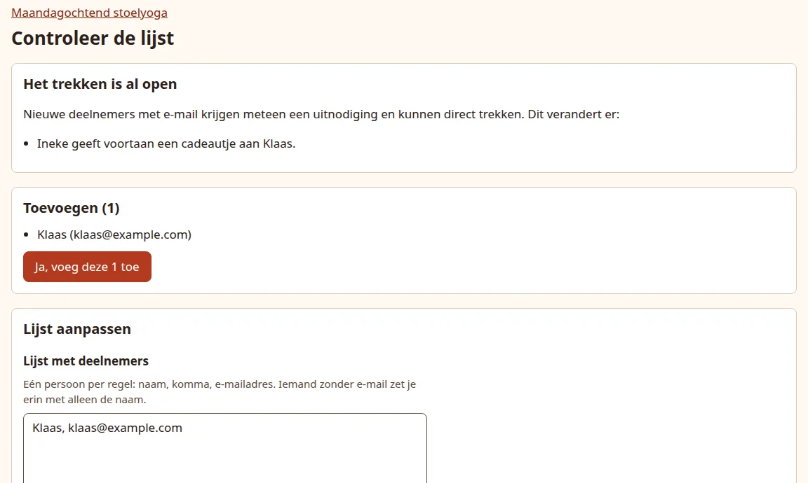
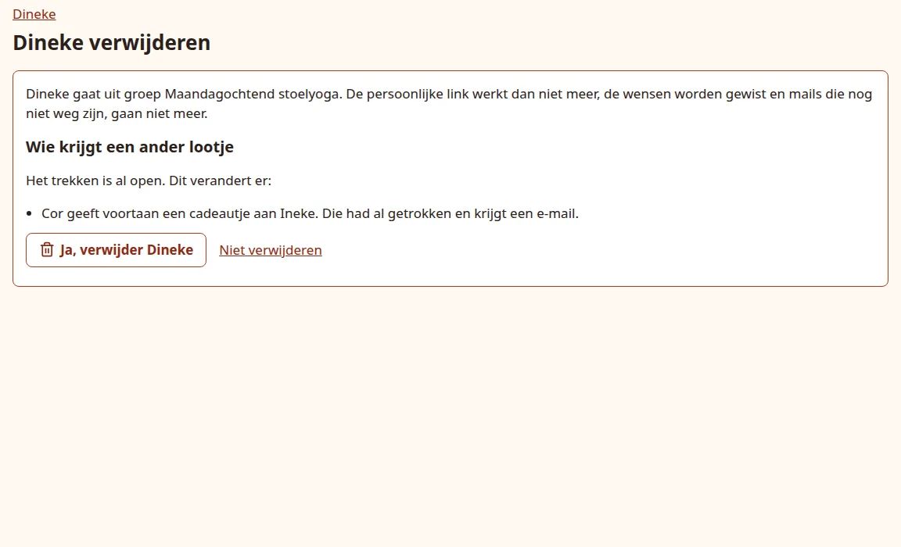

# Changes after opening

People join late, drop out or change their address, also after drawing has opened. The app keeps the circle complete and changes as little as possible: before you confirm anything, it shows exactly which pair changes and who will be told.

## Someone joins late

Paste them into the group under **Add participants**, as in [Add groups and participants](groups.md#paste-the-participants). In an open group you always get the check page first, with a **Drawing is already open** (*Het trekken is al open*) section:

{ .shot }

The newcomer is slotted into the circle: one existing giver now gives to the newcomer, and the newcomer gives to that giver's old person. The app picks a giver who has not drawn yet whenever there is one, so usually nobody notices anything. The page names the giver who changes and adds what that means:

| The giver who changes | What the page says | What happens |
| --- | --- | --- |
| has not drawn yet | only the new pair | Nothing to tell: they see their new person when they draw. |
| has drawn and has email | *They had already drawn and get an email.* | They get the mail "Your person has changed". |
| has drawn, no email | *They had already drawn and have no email: print their card again.* | Tell them yourself or print a new card. |
| has drawn, email is off | *They had already drawn. Email is off, so tell ... yourself or print their card again.* | Tell them yourself or print a new card. |

Press **Yes, add these ...** to go ahead. When someone has to be told by you, the dashboard repeats it after adding.

The newcomer can draw at once. With email on they get one invitation that says the draw has already started (subject "You can draw a name straight away", *Je kunt meteen een naam trekken*) and no separate "You can draw a name now" mail. With email off, share their link yourself.

## Someone drops out

1. Open their page from the dashboard.
2. Under **Remove** (*Verwijderen*), click **See what changes** (*Bekijken wat er verandert*).
3. Read the preview and press **Yes, remove ...** (*Ja, verwijder ...*), or **Do not remove** (*Niet verwijderen*).

{ .shot }

What removing does:

- The person leaves the group. Their personal link stops working, their wishes are erased and any of their mails not sent yet are dropped.
- **Before drawing opens**, the pairs are adjusted and nobody notices. If fewer than 3 people remain, the group has no pairs until more people are added.
- **After drawing opens**, the person who gave to the dropout takes over the dropout's person. The preview lists every giver who gets a new person, with the same notes as for a late joiner. Givers who had drawn and have email get "Your person has changed"; for the others you are told to pass it on yourself.
- In an open group nobody can leave once only 3 people would remain: the page says so and offers no button.

!!! info "The mail never says who dropped out"

    "Your person has changed" (*Je lootje is veranderd*) says only: your person has changed, you now give a present to *name*. It does not mention who left or why. When you have to tell someone yourself, the preview names that giver so you know whom to speak to.

If someone else changed the group while the preview was open, the removal is refused with **Something changed in this group in the meantime.** Look at the preview again and confirm once more.

## Change someone's details

On a person's page, **Edit details** (*Gegevens wijzigen*) has their name, email address and language. Press **Save** (*Opslaan*).

- **A new email address gets no mail by itself.** Press **Resend invitation** (*Uitnodiging opnieuw sturen*) in the Email panel afterwards. Leave the field empty for someone without email.
- If the address is already used by someone else in this event, the page warns and the button changes to **Save anyway** (*Toch opslaan*).
- Renaming someone marks the printed card of the person who gives to them as out of date, because the card shows the name.
- The language decides the language of their page, mails and card.

## A link reached the wrong person

On their page, under **Make a new link** (*Nieuwe link maken*), tick **Yes, the old link may stop working** (*Ja, de oude link mag stoppen*) and press **Make a new link**.

- The old link stops working at once, also as a QR code on paper.
- Nothing is sent. Press **Resend invitation** or share the new link yourself. Mails that were still waiting in the queue go out with the new link.

Next: [follow up](follow-up.md).
