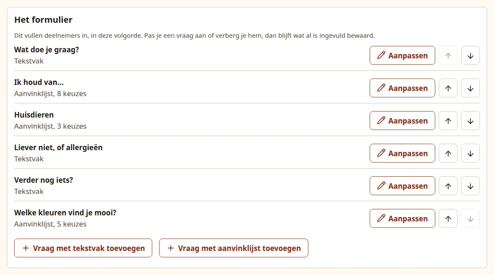
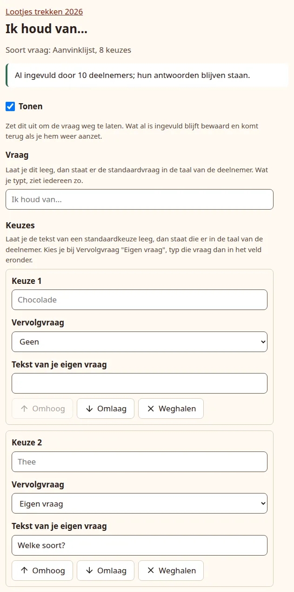

# Set up an event

An event is one gift exchange, such as "Lootjes trekken 2026". Its settings apply to every group in it: the theme text, what the wish form asks, and how long data is kept. You can change them at any time.

!!! tip "Many groups and people? Import them in one go"

    An AI chat assistant can turn your own description of the classes and the people in them into a file that creates the event, every group and every participant at once. See [Import an event from a file](import.md).

## Create the event

1. Open the organiser pages at `/admin`. The **Events** (*Evenementen*) page lists your events.
2. Under **New event** (*Nieuw evenement*), type a **Name** (*Naam*), at most 100 characters.
3. Choose the **Default language for participants** (*Standaardtaal voor deelnemers*): Nederlands or English.
4. Press **Create event** (*Evenement maken*).

{ .shot }

You land on the event page, which says the event has been created. It lists the groups, has a form for a new group, and the event settings below that.

The default language is what new participants start with. Each participant can switch language on their own page, and you can change it per person. Changing the event's language later does not change the language of people already added.

## Settings

The **Settings** (*Instellingen*) panel holds the name, the default language, the cleanup period and the theme. Press **Save** (*Opslaan*) at the bottom of the panel when you are done.

{ .shot }

**Clean up after (weeks)** (*Opruimen na (weken)*)
:   A number from 1 to 52, default 4. That many weeks after a group's exchange date, the group is erased with all its participants, wishes, pairs and mail history. The event itself stays. See [Privacy and cleanup](../self-host/privacy.md).

**Theme** (*Thema*)
:   The text participants read at the top of their page, in every mail and on the printed card. The field starts with the built-in regift text in the event's language. Leave that text as it is, or empty the field, and each participant reads the built-in text in their own language. Text you type yourself is shown exactly as typed to everyone, whatever their language. At most 2000 characters.

## The form

Under **The form** (*Het formulier*) you decide what participants are asked about themselves. Their answers help whoever draws their name pick a present. Each question is one line, in the order participants see them, with its kind: **Text box** (*Tekstvak*) for an answer they type, or **Tick list** (*Aanvinklijst*) with the number of choices. A hidden question is marked **Hidden** (*Verborgen*).

{ .shot }

- The up and down arrows next to a question move it one place.
- **Edit** (*Aanpassen*) opens the question on its own page, described below.
- **Add a question with a text box** (*Vraag met tekstvak toevoegen*) and **Add a question with a tick list** (*Vraag met aanvinklijst toevoegen*) open a new, empty question. It goes at the end of the form once saved; move it with the arrows.

A form holds at most 15 questions, hidden ones included. With 15 the add buttons make way for a message saying so.

### The standard questions

A new event starts with five standard questions. As long as you do not type your own wording, each participant reads them in their own language.

| Standard question (English / Dutch) | Kind |
| --- | --- |
| Hobbies and interests / Hobby's en interesses | Text box |
| I like... / Ik houd van... | Tick list: chocolate, tea, coffee, bath or shower products, candles, books or puzzles, plants or flowers, wine |
| Pets / Huisdieren | Tick list: dog, cat, other |
| Rather not, or allergies / Liever niet, of allergieën | Text box |
| Anything else? / Verder nog iets? | Text box |

Chocolate asks "Which flavour?" once it is ticked, and the other pet asks "Which animal?". You can change, hide or remove the standard questions like any other, but hide rather than remove one you may want back: see [Hide or remove a question](#hide-or-remove-a-question).

### Change a question

Press **Edit** (*Aanpassen*) next to the question. Its page has:

**Show** (*Tonen*)
:   Turn it off to leave the question out of the form. See [Hide or remove a question](#hide-or-remove-a-question).

**Question** (*Vraag*)
:   The wording, one line of at most 80 characters. On a standard question the field shows the standard wording in grey: leave it empty and each participant reads that wording in their own language. Wording you type is shown exactly as typed to everyone. A question you added always needs wording.

**Choices** (*Keuzes*), on a tick list only
:   One block per choice, from **Choice 1** (*Keuze 1*) down, described in the next section.

Press **Save** (*Opslaan*) to store the question; the page then goes back to the event. The buttons that add, move or remove a choice only change the page you are editing: nothing is stored until you press **Save**. If something is missing, the page says **Not saved yet** (*Nog niet opgeslagen*) and marks the field.

Whether a question is a text box or a tick list cannot be changed. To change it, add a new question of the other kind and hide or remove the old one.

{ .shot width="420" }

### The choices of a tick list

Each choice has:

- **Its text.** On a standard choice, such as *Thee*, the field shows the standard text in grey: leave it empty and each participant sees the choice in their own language. Text you type is shown exactly as typed to everyone. At most 80 characters.
- **Follow-up question** (*Vervolgvraag*): what the choice asks once it is ticked, in a small text field under it.
    - **None** (*Geen*): a plain tick box.
    - **General question** (*Algemene vraag*): "Anything in particular?" in each participant's language. On the standard chocolate choice it is "Which flavour?", on the standard other pet "Which animal?".
    - **Your own question** (*Eigen vraag*): type it in **Text of your own question** (*Tekst van je eigen vraag*). It is shown exactly as typed to everyone, and ends in one question mark, added if you leave it out. Typing the general question itself, such as "Welke smaak?" on chocolate, in any language, saves it as **General question**, so it stays translated.
- **Up** (*Omhoog*), **Down** (*Omlaag*) and **Remove** (*Weghalen*).

**Add a choice** (*Keuze toevoegen*) adds an empty choice at the end. A tick list has 1 to 30 choices.

Typing in a follow-up field ticks its box, so an answer is never lost because someone forgot the tick.

### What happens to the answers

Participants see the changed form the next time they open their page. Nobody gets a mail about it.

- **Changing wording keeps the answers.** That goes for a question's wording, a choice's text and a follow-up question: ticks and typed answers stay with the question or choice.
- **Switching a follow-up question to None** (*Geen*) hides what participants typed in it from their giver. It is kept, and shows again when you switch the follow-up question back on.
- **Removing a choice that has been ticked** asks for confirmation when you press **Save**: **Remove ticked choices?** (*Aangevinkte keuzes weghalen?*) names the choices and how many participants lose that tick. Tick **Yes, I am sure** (*Ja, ik weet het zeker*) and press **Save** again. Those ticks are erased, with whatever was typed under them. A choice nobody ticked is removed without asking.

### Hide or remove a question

**Hiding** a question, by turning off **Show** (*Tonen*), keeps everything: the question disappears from the form, the result page, the "wishes updated" mail and the printed card, and the answers already given come back when you show it again.

- On the dashboard, someone whose only answers are in hidden questions counts as not having filled in their wishes.
- With every question hidden there is nothing to ask, so no wish reminders are sent.

**Removing** a question is for good. It is at the bottom of the question's page, under **Remove question** (*Vraag verwijderen*), which also says how many participants answered it, if anyone did. Tick **Yes, I am sure** (*Ja, ik weet het zeker*) and press **Remove question**: the question leaves the form and all answers to it are erased. This cannot be undone.

The last question of a form cannot be removed. Turn off **Show** to leave it out.

A removed standard question or choice cannot be brought back as it was: adding it again with the same words makes one of your own, shown exactly as typed to everyone and no longer translated. Hide a standard question rather than remove it if you may want it back.

## What changing settings does to printed cards

A printed card shows the theme and the wishes, so changing the theme or anything in the form (a question, its wording, its order, whether it is shown, or its choices) marks every printed card of the event as out of date. The dashboard then says **Print again** (*Opnieuw printen*) for those cards. Saving the settings or a question without a real change, also after switching the event language, does not.

## Delete an event

At the bottom of the event page, **Delete event** (*Evenement verwijderen*) erases the event with all its groups, participants and wishes at once. Tick **Yes, I am sure** (*Ja, ik weet het zeker*) first. This cannot be undone.

Next: [add groups and participants](groups.md).
