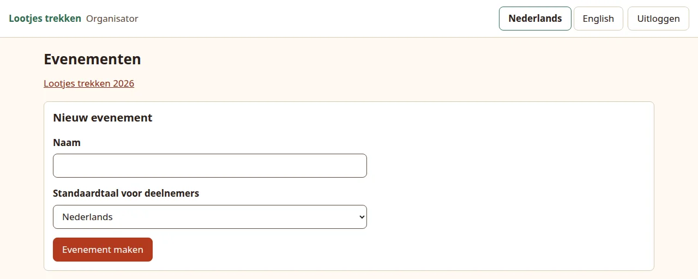
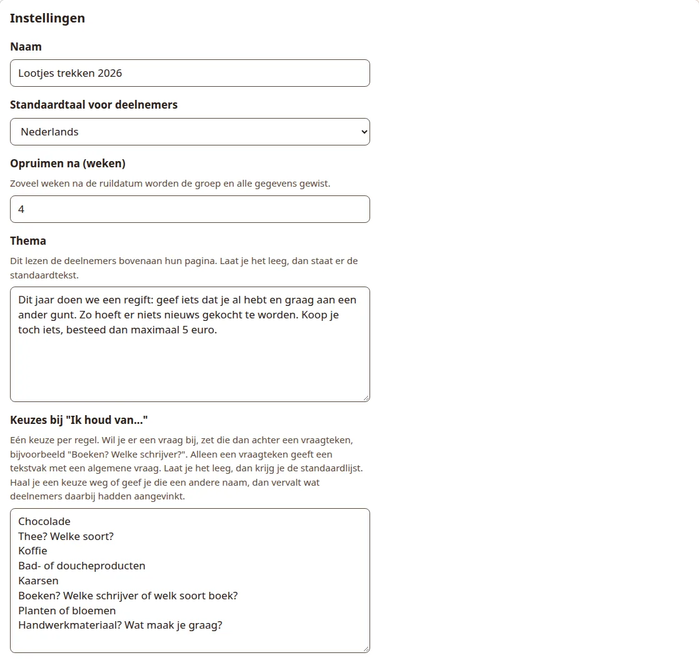
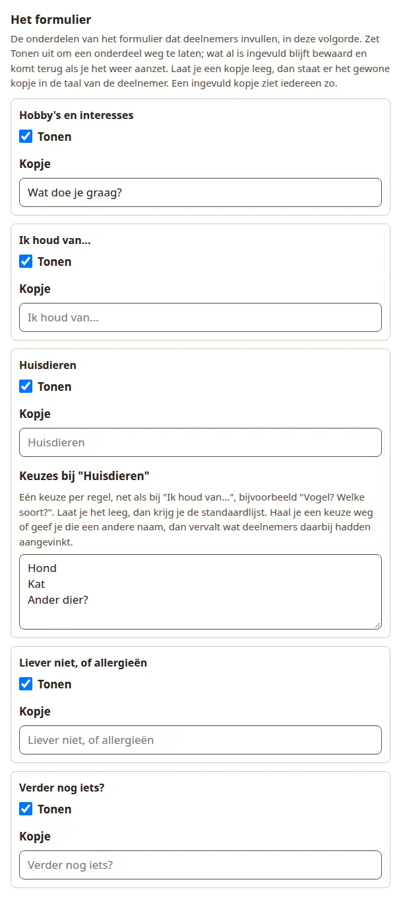

# Set up an event

An event is one gift exchange, such as "Lootjes trekken 2026". Its settings apply to every group in it: the theme text, what the wish form asks, and how long data is kept. You can change them at any time.

## Create the event

1. Open the organiser pages at `/admin`. The **Events** (*Evenementen*) page lists your events.
2. Under **New event** (*Nieuw evenement*), type a **Name** (*Naam*), at most 100 characters.
3. Choose the **Default language for participants** (*Standaardtaal voor deelnemers*): Nederlands or English.
4. Press **Create event** (*Evenement maken*).

{ .shot }

You land on the event page, which says the event has been created. It lists the groups, has a form for a new group, and the event settings below that.

The default language is what new participants start with. Each participant can switch language on their own page, and you can change it per person. Changing the event's language later does not change the language of people already added.

## Settings

The **Settings** (*Instellingen*) panel holds everything that is shared by the groups. Press **Save** (*Opslaan*) at the bottom of the panel when you are done.

{ .shot }

**Clean up after (weeks)** (*Opruimen na (weken)*)
:   A number from 1 to 52, default 4. That many weeks after a group's exchange date, the group is erased with all its participants, wishes, pairs and mail history. The event itself stays. See [Privacy and cleanup](../self-host/privacy.md).

**Theme** (*Thema*)
:   The text participants read at the top of their page, in every mail and on the printed card. The field starts with the built-in regift text in the event's language. Leave that text as it is, or empty the field, and each participant reads the built-in text in their own language. Text you type yourself is shown exactly as typed to everyone, whatever their language. At most 2000 characters.

**Choices under "I like..."** (*Keuzes bij "Ik houd van..."*)
:   The tick boxes participants see under "I like...". One choice per line. Empty the field to go back to the built-in list (chocolate, tea, coffee, bath or shower products, candles, books or puzzles, plants or flowers, wine).

### Ask a short question with a choice

A choice can open a small text field when it is ticked. Write the question after a question mark:

```text
Chocolade?
Thee? Welke soort?
Boeken? Welke schrijver of welk soort boek?
Kaarsen
```

- `Thee? Welke soort?` shows the tick box "Thee" and, under it, the question "Welke soort?".
- A question mark alone, as in `Boeken?`, asks "Anything in particular?" in the participant's language.
- The built-in chocolate choice is the exception: `Chocolade?` keeps asking "Which flavour?". Without the question mark (`Chocolade`) it asks nothing.
- A choice without a question mark, such as `Kaarsen`, is a plain tick box.

Typing in the question field ticks its box, so an answer is never lost because someone forgot the tick.

The built-in choices are translated for each participant, also when you edit the list, as long as a line still carries the built-in name in Dutch or English (`Thee` or `Tea`). Choices and questions you type yourself are shown as typed, to everyone.

!!! warning "Removing or renaming a choice drops its ticks"

    If you remove a line, or change its words, whatever participants had ticked for that choice is dropped. Changing only capital letters, or adding or removing a question on an existing choice, keeps the ticks.

## The form

Under **The form** (*Het formulier*) you choose which parts of the wish form participants see. The parts always appear in this order:

| Part | Built-in heading (English / Dutch) |
| --- | --- |
| Hobbies | Hobbies and interests / Hobby's en interesses |
| I like | I like... / Ik houd van... |
| Pets | Pets / Huisdieren |
| Rather not | Rather not, or allergies / Liever niet, of allergieën |
| Anything else | Anything else? / Verder nog iets? |

{ .shot width="420" }

For each part:

- **Show** (*Tonen*): untick it to leave the part out. A hidden part disappears from the form, the result page, the "wishes updated" mail and the printed card. Answers already given are kept and come back when you show the part again.
- **Heading** (*Kopje*): leave it empty and each participant sees the built-in heading in their own language. A heading you type (one line, at most 80 characters) is shown as typed to everyone. The example above renames "Hobbies and interests" to "Wat doe je graag?".

The **Pets** part has its own list, **Choices under "Pets"** (*Keuzes bij "Huisdieren"*). It works like the "I like..." list, including questions after a question mark, for example `Vogel? Welke soort?`. Empty, it gives Dog, Cat and Other, where Other asks "Which animal?". Removing or renaming a pet choice drops its ticks too.

What a hidden part means elsewhere:

- On the dashboard, someone whose only answers are in hidden parts counts as not having filled in their wishes.
- With every part hidden there is nothing to ask, so no wish reminders are sent.

## What changing settings does to printed cards

A printed card shows the theme and the wishes, so changing the theme, the choices, the parts or the headings marks every printed card of the event as out of date. The dashboard then says **Print again** (*Opnieuw printen*) for those cards. Saving the page without a real change, also after switching the event language, does not.

## Delete an event

At the bottom of the event page, **Delete event** (*Evenement verwijderen*) erases the event with all its groups, participants and wishes at once. Tick **Yes, I am sure** (*Ja, ik weet het zeker*) first. This cannot be undone.

Next: [add groups and participants](groups.md).
