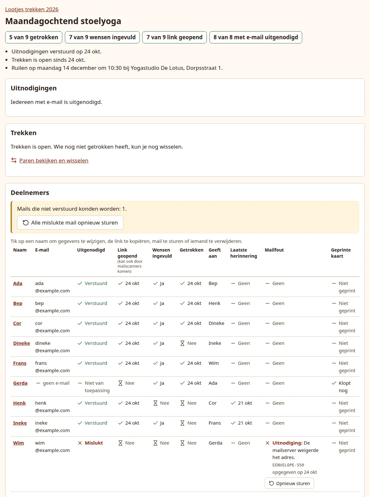
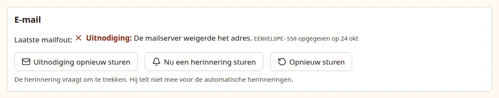

# Follow up

The group dashboard shows where everyone is. With email on, the app also sends reminders by itself and retries mail that did not go through; you only step in for the people it cannot reach.

## Read the dashboard

{ .shot }

At the top, the counts: how many have drawn, filled in their wishes and opened their link, and with email on how many people with email were invited. Someone counts as invited once their invitation was delivered; a queued, retrying or failed invitation does not count. Below them: when the invitations went out, whether and since when drawing is open (or when it opens by itself), and the exchange date, time and place.

The **Participants** (*Deelnemers*) table has one row per person. Click a name to open their page.

| Column | Shows |
| --- | --- |
| **Email** | Their address, or *no email*. |
| **Invited** (*Uitgenodigd*) | Email on only. The state of their invitation: Queued, Sent, Failed, retrying, or Failed. *Not yet* before you send the invitations; *Not applicable* without an address. |
| **Link opened** (*Link geopend*) | The date they first opened their page. With email on this can include mail scanners that test links. |
| **Wishes filled in** (*Wensen ingevuld*) | Yes once anything is filled in, in a question of the form that is shown. |
| **Drawn** (*Getrokken*) | The date they drew. |
| **Gives to** (*Geeft aan*) | Their person. Keep this screen to yourself. |
| **Last reminder** (*Laatste herinnering*) | Email on only. The date of their latest reminder. |
| **Mail failure** (*Mailfout*) | Email on only. Their latest mail that failed, with the reason and a **Send again** button. |
| **Printed card** (*Geprinte kaart*) | Not printed, Up to date, or Print again. See [Print a card](in-person.md#print-a-card). |

On a phone the table turns into a list of cards, one per person.

## Reminders

With email on, the app reminds people by itself. Everything in this section is automatic; you do not have to do anything.

- **Wishes reminder** (*"Vertel je nog iets over jezelf?"*): before drawing opens, to someone who has not filled in anything yet. It says filling in is welcome but not required. The first goes out no sooner than 5 days after the invitation, or, when the group opens by itself, 3 days before that opening date. A second follows at least 4 days later. With every question of the form hidden, none are sent.
- **Draw reminder** (*"Vergeet niet een naam te trekken"*): after drawing opens, to someone who has not drawn. The first goes out 3 days after opening, the second from a week before the exchange date, and at least 3 days after the first.

For both:

- At most two of each kind per person, only to people with email who were invited, and never sooner than 3 days after their invitation.
- They go out at 09:00 (in the app's time zone) and only between 09:00 and 20:00. One that becomes due later in the day, for example because the app was down in the morning, waits until 09:00 the next day.
- None are sent on or after the exchange date.
- A reminder that has become pointless while it waited, because the person filled in their wishes or drew in the meantime, is dropped.

### Send a reminder yourself

On a person's page, the **Email** (*E-mail*) panel has **Send a reminder now** (*Nu een herinnering sturen*). It sends the reminder that fits: to fill in wishes before drawing opens, to draw after. The hint below the button says which. It only appears when there is something to remind about and after the invitation has gone out.

A reminder you send by hand does not count toward the two automatic ones, but the next automatic one keeps its spacing after it.

## Mail the app sends by itself

Besides the invitations, the draw-open mail and the reminders:

- **Wishes updated** (*"... heeft de wensen aangepast"*): when someone changes their wishes after the person who gives to them has drawn, that giver gets a short mail with the new wishes. It goes out about 15 minutes after the first change, and further changes in that window go into the same mail. It is not sent from the exchange date on, and not to a giver who has not drawn yet (they see the wishes when they draw).
- **Your person has changed** (*"Je lootje is veranderd"*): to a giver who had drawn and gets a new person because someone joined or dropped out. See [Changes after opening](changes.md).

All other mail goes out within a minute.

## When a mail fails

The app works through its mail queue every minute. A mail that cannot be sent is tried again after 1, 5, 30 and 120 minutes. While it is being retried it shows as *retrying* and needs nothing from you; after the last try it shows *gave up on* a date, with a **Send again** button.

{ .shot }

The **Mail failure** column says in words what went wrong, with the technical code in small print beside it for whoever runs the mail server:

| Reason shown | Usual cause |
| --- | --- |
| The mail server could not be reached. | Wrong `SMTP_HOST` or port, or the server is down. |
| The mail server did not answer in time. | Network trouble or an overloaded server. |
| Logging in to the mail server failed. | Wrong `SMTP_USER` or `SMTP_PASS`. |
| A secure connection to the mail server failed. | The server's encryption setup, or the wrong port. |
| The mail server refused the address. | A typo in the address, or a mailbox that does not exist (code such as `EENVELOPE-550`). |
| The mail server refused the sender address. | The server will not send from `SMTP_FROM`. |
| The mail server refused the mail. | The server rejected the message itself. |
| The mail server could not take the mail just now. | A temporary refusal; sending again later usually works. |
| The mail could not be sent. | Anything else; check the app's log. |

To fix it:

1. For a refused address, check and correct it under **Edit details** on the person's page.
2. Press **Send again** (*Opnieuw sturen*) in the Mail failure column or on the person's page. When several mails failed, the dashboard shows **Mails that could not be sent: ...** with **Send all failed mail again** (*Alle mislukte mail opnieuw sturen*).
3. If every mail fails, or the reason is a refused sender, the problem is the mail server settings; see [Troubleshooting](../troubleshooting.md#the-dashboard-shows-a-mail-failure).

Some details that explain what you see:

- Only the latest mail of each kind per person counts. A failure that a later mail of the same kind replaced is not shown or sent again.
- Mail that was skipped because it could not apply, such as one for a person without an email address, is not shown as a failure.
- An invitation or "You can draw a name now" sent again after that person has drawn is skipped, so it does not ask them to start over.
- An invitation that reached the person earlier stays marked as sent; only the failed resend shows in the failure column.

**Resend invitation** (*Uitnodiging opnieuw sturen*) on a person's page sends the invitation mail again with their current link, for example after they lost it. If one is already waiting in the queue, nothing extra is sent and the page says so.
