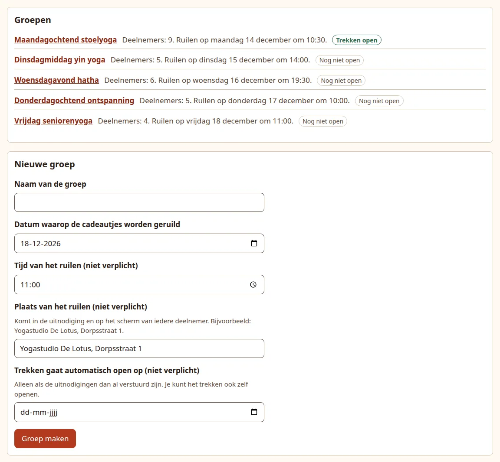
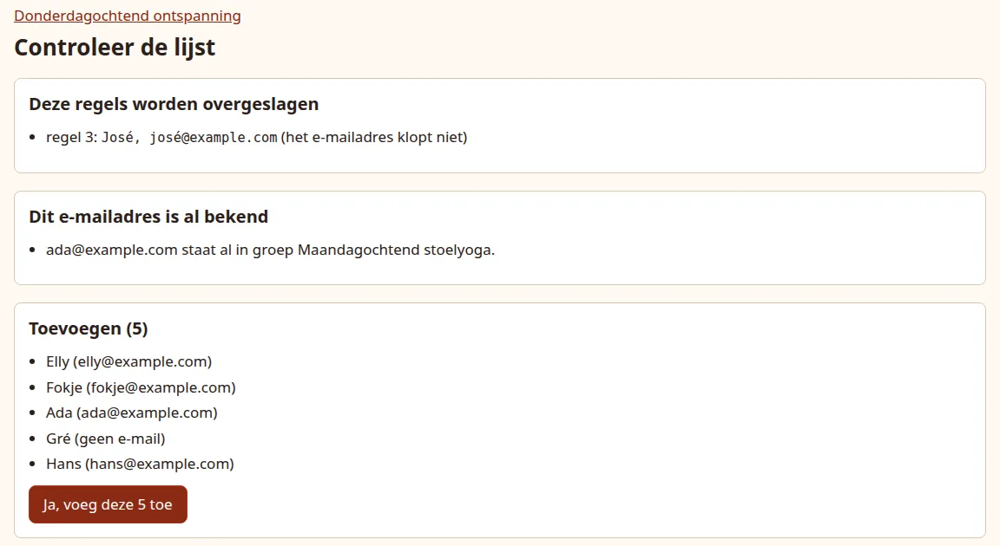

# Add groups and participants

Make one group per class, team or family. Each group has its own exchange date and its own draw: people only draw names from their own group.

## Create a group

On the event page, fill in **New group** (*Nieuwe groep*) and press **Create group** (*Groep maken*).

{ .shot }

| Field | Required | What it does |
| --- | --- | --- |
| **Group name** (*Naam van de groep*) | yes | For example "Maandagochtend stoelyoga". At most 100 characters. Participants do not see it. |
| **Date the presents are exchanged** (*Datum waarop de cadeautjes worden geruild*) | yes | Shown to participants. Reminders stop on this date, and cleanup counts from it. It cannot be in the past. While sign-up runs it must be after the sign-up closing date. |
| **Time of the exchange** (*Tijd van het ruilen*) | no | For example `10:30`. |
| **Place of the exchange** (*Plaats van het ruilen*) | no | One line, at most 200 characters, for example "Yogastudio De Lotus, Dorpsstraat 1". |
| **Drawing opens automatically on** (*Trekken gaat automatisch open op*) | no | On this date drawing opens by itself at 09:00, but only if the invitations were sent by then. It must be on or before the exchange date. While sign-up runs it must be after the sign-up closing date. See [Open the draw](open.md#let-it-open-by-itself). |

The time and place, when set, appear next to the date in every mail, on every participant screen and on the printed card. In Dutch that reads "We geven de cadeautjes op maandag 14 december om 10:30 bij Yogastudio De Lotus, Dorpsstraat 1."; in English "We give the presents on Monday 14 December at 10:30, at Yogastudio De Lotus, Dorpsstraat 1."

The form for a new group starts filled in with the date, time, place and opening date of the group you created last (the opening date only if it is still ahead), so groups that meet in the same place need no retyping. Change the name and whatever differs.

You land on the new group's page, the **dashboard**, with the message that the group has been created.

## Paste the participants

Under **Add participants** (*Deelnemers toevoegen*), paste or type one person per line, then press **Check and add** (*Controleren en toevoegen*):

```text
Ada, ada@example.com
Bep, bep@example.com
Gerda
Henk; henk@example.com
```

- **Name, then email address.** A comma, a semicolon or a tab separates the two, so a list copied from a spreadsheet works too. A separator at the end of a line, as a spreadsheet export often leaves, is ignored.
- **Someone without email** is just their name, like `Gerda` above.
- **Each person once.** A line with a name that an earlier line of the same list already has is skipped, so one person never gets two links and two pairs. Names count as the same whatever their capitals or surrounding spaces. If two different people share a name, make the names differ, for example `Anne de Vries` and `Anne Bakker`. Two people may share one email address, such as a couple; that is only a warning (see below).
- Names may contain emoji and accents, up to 100 characters.
- Up to 500 people per paste.

When every line is fine, the people are added straight away and the dashboard says **Added.** (*Toegevoegd.*). Otherwise you first see a **Check the list** (*Controleer de lijst*) page:

{ .shot }

**These lines are skipped** (*Deze regels worden overgeslagen*)
:   Lines that cannot be added, each with its line number and the reason:

    - *the name is missing*: the line has only an address, or nothing before the separator;
    - *put a comma between the name and the email address*: the name and the address are there, but nothing separates them;
    - *the email address comes before the name*: swap them;
    - *this line holds more than a name and an email address*: there is a third column;
    - *the email address is not valid*: the part after the separator is not an address;
    - *this name is already on line ...*: the person is already in the list on that line.

    Nothing from a skipped line is added. Fix it in the box at the bottom and check again, or add the others first and paste the fixed line afterwards.

    An address with an accented letter or emoji before the `@`, such as `josé@example.com`, is refused because mail servers and the email field on the participant's page do not accept it. An accented domain such as `ada@café.nl` is fine: it is stored and shown in its punycode form, `ada@xn--caf-dma.nl`, which is the same address written the way mail servers read it.

**This email address is already known** (*Dit e-mailadres is al bekend*)
:   The address is already used by someone in another group of this event (*staat al in groep ...*), or appears under two different names in the list (*staat twee keer in de lijst*). This is a warning only: those people are still in the list to add. Leave them in if, for example, one person joins two classes or a couple shares one address; otherwise fix the list.

**To add** (*Toevoegen*)
:   Everyone who will be added. Press **Yes, add these ...** (*Ja, voeg deze ... toe*) to add them, or change the list in the box at the bottom and press **Check and add** again.

## How pairing works

The app pairs everyone the moment they are added, unless the event's [sign-up](signup.md) is on. It arranges the whole group in one big circle: Ada gives to Bep, Bep to Cor, and so on, until the last person gives to Ada. So nobody gets themselves and no two people simply swap presents. People added later are slotted into the circle.

- A group needs **at least 3 people** before there are pairs. Until then the dashboard shows **Not paired yet** (*Nog niet ingedeeld*) and a warning.
- With **exactly 3**, anyone who has drawn can work out every pair, because a circle of three can only be arranged one way. The dashboard warns about this; it is allowed, but the surprise is smaller.
- **While sign-up runs, nobody is paired**, whatever the group's size, and the dashboard shows **Not paired yet** for everyone. The pairs are made from the people who said yes when you [start the draw](signup.md#start-the-draw).
- Drawing does not decide anything: it reveals the pair that was already set. You can look at the pairs and swap them before people draw; see [Check pairs and open the draw](open.md).

Participants start with the event's default language. If the invitations of the group have already been sent, newcomers with an email address get their invitation straight away. While sign-up is open they get the sign-up mail instead; see [Add or remove people](signup.md#add-or-remove-people).

## Change or delete a group

At the bottom of the dashboard:

- **Edit group** (*Groep aanpassen*) has the same fields as the new group form. Changing the date, time or place marks printed cards of the group as out of date. Dates that have passed may stay as they are, so you can still rename a group after its exchange.
- **Delete group** (*Groep verwijderen*) erases the group with all its participants, wishes and pairs at once, after you tick **Yes, I am sure**. This cannot be undone.

Next: [ask who takes part](signup.md) if you want to, or [send the invitations](invitations.md).
