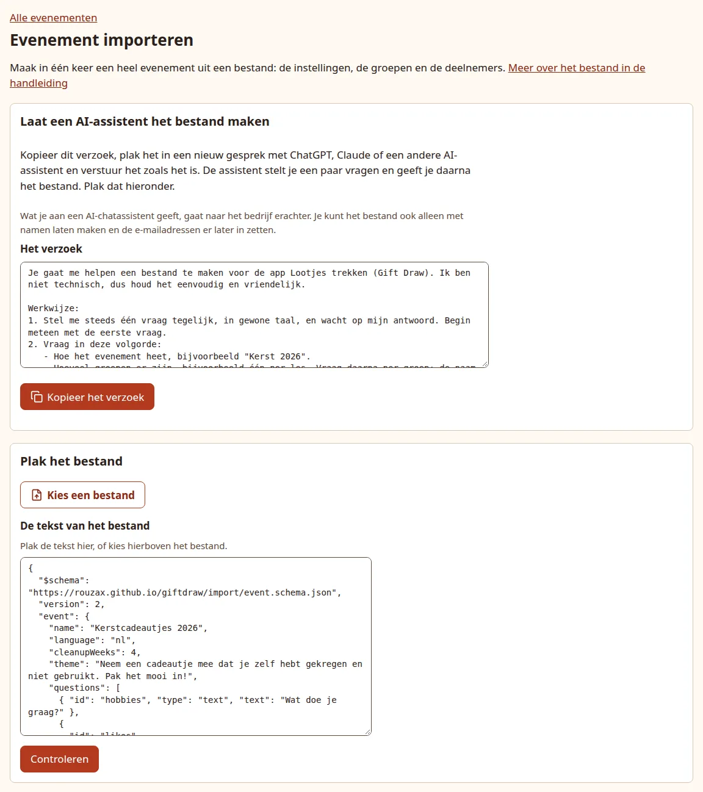
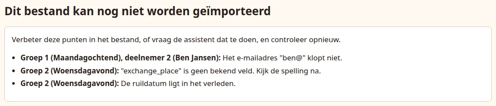
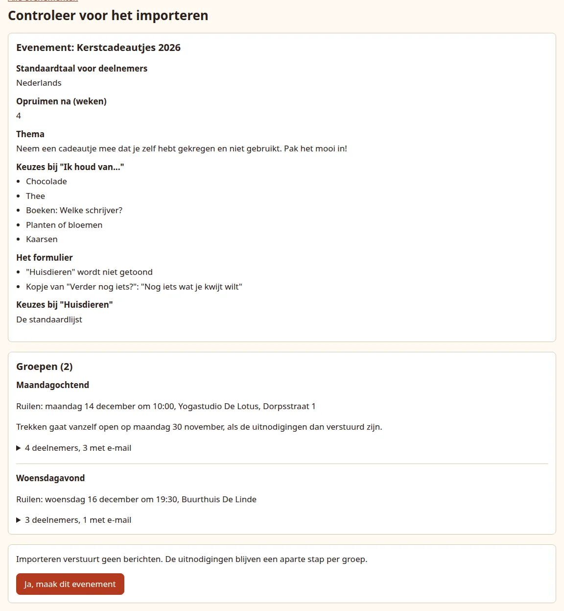

# Import an event from a file

Instead of typing an event, its groups and every participant into the forms, you can describe them once in a file and import that. The file is plain text in a fixed format (JSON). You do not have to write it yourself: an AI chat assistant such as ChatGPT, Claude or Gemini can turn your own description into the file, using the request below.

An import does exactly what the forms would do, in one go:

- It always creates a **new** event, with its settings and the questions of its wish form. It never changes or adds to an event you already have.
- It creates every group with its date, time, place and auto-open date.
- It adds the participants and pairs everyone in each group of 3 or more, the same way pasting a list does. Every participant gets their own link.
- It sends **no mail**. Invitations stay a separate step for each group, as in [Send the invitations](invitations.md).

The file never holds pairs, links or who has drawn, so it cannot be used to restore an event or to open anyone's page.

!!! warning "What you give an AI assistant goes to the company behind it"

    Names and email addresses you type into a chat assistant are sent to that company. If you would rather not share them, let the assistant make the file with names only (or with the groups only), import that, and add the email addresses afterwards on each person's page or by pasting the list into the group. See [Add groups and participants](groups.md).

## Before you start

- You can log in to the organiser pages.
- You know, per group: its name, the exchange date, and if you like the time, the place and the date drawing should open by itself.
- You have the list of people per group. An email address is optional for each person.

## 1. Have the file written

There are two ways to ask the assistant. If you are not sure, take the first.

### Let the assistant ask you

The quickest way is the app's own import page: choose **Import an event from a file** (*Evenement importeren uit een bestand*) on the **Events** (*Evenementen*) page and press **Copy the request** (*Kopieer het verzoek*). It copies the request below in your admin language. Paste it into a new chat and send it as it is: there is nothing to fill in. The assistant then asks you one thing at a time, in plain words: the name of the event, the groups with their dates, who is in each group, whether you want your own theme text, and what you want to know from the participants. You can paste a list of names when it asks for the people. Email addresses are optional; you can leave them out and add them later in the app.

For the wish form, the assistant shows you the five standard questions and asks whether to keep them, leave one out or word one differently, and whether to add questions of your own. For each question you add, it asks whether participants type an answer or tick choices in a list, and for a list, which choices. Keeping the standard questions is fine; you can also change the form later on the event page.

When it has everything, the assistant shows a short summary in plain words. Check it, say what is wrong or that it is right, and only then does it give you the file.

=== "Nederlands"

    ```text
    Je gaat me helpen een bestand te maken voor de app Lootjes trekken (Gift Draw). Ik ben niet technisch, dus houd het eenvoudig en vriendelijk.

    Werkwijze:
    1. Stel me steeds één vraag tegelijk, in gewone taal, en wacht op mijn antwoord. Begin meteen met de eerste vraag.
    2. Vraag in deze volgorde:
       - Hoe het evenement heet, bijvoorbeeld "Kerst 2026".
       - Hoeveel groepen er zijn, bijvoorbeeld één per les. Vraag daarna per groep: de naam, de datum waarop de cadeautjes worden geruild, en of ik een tijd en een plaats wil noemen (dat hoeft niet).
       - Per groep: wie er meedoen. Zeg erbij dat ik de namen onder elkaar mag plakken of typen, met een e-mailadres erachter als ik dat wil. E-mailadressen zijn niet nodig; ik kan ze later ook in de app toevoegen.
       - Of ik een eigen tekst voor de deelnemers wil, of de standaardtekst van de app. De standaardtekst is prima.
       - Wat ik van de deelnemers wil weten, zodat wie een cadeautje voor iemand zoekt op een idee komt. Laat me de vijf standaardvragen van de app zien (hieronder bij de regels) en vraag of ik die zo wil houden, of ik er een wil weglaten of anders wil zeggen, en of ik er een vraag bij wil.
       - Per vraag die ik erbij wil: hoe de vraag luidt, en of de deelnemers zelf iets typen of iets aanvinken uit een lijstje. Bij een lijstje: welke keuzes erin staan, en of er bij een keuze nog een vraag moet komen als die is aangevinkt, zoals "Welke soort?".
    3. Is iets niet duidelijk, zoals een datum zonder jaartal, vraag het dan. Verzin nooit namen, datums, e-mailadressen, vragen of keuzes. Weet je de datum van vandaag niet zeker, vraag die dan.
    4. Zet daarna alles in een korte samenvatting in gewone woorden, zonder code, en vraag of het klopt.
    5. Pas als ik zeg dat het klopt, geef je het bestand: alleen de JSON, in één codeblok. Zeg erbij: "Kopieer alles in het blok en plak het in Lootjes trekken bij Evenement importeren uit een bestand."

    Regels voor het bestand (die hoef je mij niet uit te leggen):
    - Bovenaan staan precies drie velden: "version": 2, "event" en "groups".
    - "event" heeft "name" (hoogstens 100 tekens) en "language": "nl". Alleen als ik een eigen tekst wil: "theme" (hoogstens 2000 tekens).
    - De vijf standaardvragen, met hun "id" en "type":
      - "hobbies", "text": Hobby's en interesses.
      - "likes", "choices": Ik houd van..., om aan te vinken: "Chocolade?", "Thee", "Koffie", "Bad- of doucheproducten", "Kaarsen", "Boeken of puzzels", "Planten of bloemen", "Wijn".
      - "pets", "choices": Huisdieren, om aan te vinken: "Hond", "Kat", "Ander dier?".
      - "avoid", "text": Liever niet, of allergieën.
      - "other", "text": Verder nog iets?
    - Schrijf "Chocolade?" en "Ander dier?" precies zo, met alleen een vraagteken: de app vraagt dan zelf "Welke smaak?" en "Welk dier?", in de taal van elke deelnemer.
    - Wil ik de vijf standaardvragen zo houden, zonder vragen erbij, laat "questions" dan weg. Anders heeft "event" een lijst "questions" met alle vragen van het formulier, in de volgorde waarin deelnemers ze zien. Een standaardvraag die ik houd, staat er dus ook in; een die ik weglaat, niet.
    - Een standaardvraag schrijf je als {"id": "hobbies", "type": "text"}. Alleen als ik hem anders wil zeggen: "text" met mijn woorden. Alleen als ik de keuzes bij "likes" of "pets" verander: "choices" met de hele nieuwe lijst, met de standaardkeuzes precies zoals hierboven geschreven.
    - Een eigen vraag heeft geen "id": {"type": "text", "text": "..."} als de deelnemers zelf iets typen, of {"type": "choices", "text": "...", "choices": ["...", "..."]} voor een lijstje om aan te vinken.
    - Een keuze is een tekst, zoals "Kaarsen". Een vraag bij een keuze komt na een vraagteken: "Boeken? Welke schrijver?". Alleen een vraagteken, zoals "Wijn?", vraagt "Iets in het bijzonder?". Staat er een vraagteken in de keuze zelf, schrijf de keuze dan als {"label": "...", "question": "..."}.
    - Schrijf elke vraag zoals de deelnemers hem lezen, tegen hen gezegd met "je": "Wat is je lievelingsauto?", niet "Wat is hun lievelingsauto?". Dat geldt ook voor een vraag bij een keuze.
    - Een vraag, een keuze en een vraag bij een keuze zijn elk hoogstens 80 tekens. Het formulier heeft hoogstens 15 vragen, een lijstje hoogstens 30 keuzes.
    - "groups" is een lijst met per groep "name", "exchangeDate" (JJJJ-MM-DD, niet in het verleden) en "participants". Alleen als ik ze noem: "exchangeTime" (UU:MM, 24 uur) en "exchangePlace" (één regel).
    - "participants" is een lijst met per persoon de naam als tekst, of {"name": "...", "email": "..."} als ik een e-mailadres geef. Geef twee mensen in één groep nooit precies dezelfde naam; vraag me dan hoe ik ze uit elkaar houd.
    - Gebruik de veldnamen precies zoals hier geschreven, en geen andere. De volledige beschrijving staat op https://rouzax.github.io/giftdraw/import/event.schema.json
    ```

=== "English"

    ```text
    You are going to help me make a file for the app Gift Draw (Lootjes trekken). I am not technical, so keep it simple and friendly.

    How to work:
    1. Ask me one question at a time, in plain words, and wait for my answer. Start with the first question straight away.
    2. Ask in this order:
       - What the event is called, for example "Christmas 2026".
       - How many groups there are, for example one per class. Then, per group: its name, the date the presents are exchanged, and whether I want to give a time and a place (I do not have to).
       - Per group: who takes part. Tell me I can paste or type the names one below the other, with an email address after a name if I like. Email addresses are not needed; I can also add them later in the app.
       - Whether I want my own text for the participants, or the app's standard text. The standard text is fine.
       - What I want to know from the participants, so that whoever looks for a present for someone gets an idea. Show me the app's five standard questions (below, in the rules) and ask whether I want to keep them as they are, leave one out or word one differently, and whether I want to add a question.
       - For each question I add: how it is worded, and whether participants type something themselves or tick things in a list. For a list: which choices are in it, and whether a choice should ask something more once it is ticked, such as "Which kind?".
    3. If something is unclear, such as a date without a year, ask. Never make up names, dates, email addresses, questions or choices. If you are not sure of today's date, ask me.
    4. Then put everything in a short summary in plain words, without code, and ask whether it is right.
    5. Only when I say it is right, give me the file: only the JSON, in one code block. Add: "Copy everything in the block and paste it into Gift Draw under Import an event from a file."

    Rules for the file (no need to explain them to me):
    - At the top there are exactly three fields: "version": 2, "event" and "groups".
    - "event" has "name" (at most 100 characters) and "language": "en". Only if I want my own text: "theme" (at most 2000 characters).
    - The five standard questions, with their "id" and "type":
      - "hobbies", "text": Hobbies and interests.
      - "likes", "choices": I like..., to tick: "Chocolate?", "Tea", "Coffee", "Bath or shower products", "Candles", "Books or puzzles", "Plants or flowers", "Wine".
      - "pets", "choices": Pets, to tick: "Dog", "Cat", "Other?".
      - "avoid", "text": Rather not, or allergies.
      - "other", "text": Anything else?
    - Write "Chocolate?" and "Other?" exactly like that, with only a question mark: the app then asks "Which flavour?" and "Which animal?" itself, in each participant's language.
    - If I keep the five standard questions as they are, with no questions added, leave out "questions". Otherwise "event" has a list "questions" with every question of the form, in the order participants see them. So a standard question I keep is in it too; one I leave out is not.
    - Write a standard question as {"id": "hobbies", "type": "text"}. Only if I want it worded differently: "text" with my words. Only if I change the choices of "likes" or "pets": "choices" with the whole new list, with the standard choices written exactly as above.
    - A question of my own has no "id": {"type": "text", "text": "..."} when participants type something themselves, or {"type": "choices", "text": "...", "choices": ["...", "..."]} for a list to tick.
    - A choice is a text, such as "Candles". A question with a choice comes after a question mark: "Books? Which author?". A question mark alone, such as "Wine?", asks "Anything in particular?". If the choice itself contains a question mark, write it as {"label": "...", "question": "..."}.
    - Word every question the way participants read it, addressed to them as "you": "What is your favourite car?", not "What is their favourite car?". The same goes for a question with a choice.
    - A question, a choice and a question with a choice are each at most 80 characters. The form has at most 15 questions, a list at most 30 choices.
    - "groups" is a list with, per group, "name", "exchangeDate" (YYYY-MM-DD, not in the past) and "participants". Only if I mention them: "exchangeTime" (HH:MM, 24-hour) and "exchangePlace" (one line).
    - "participants" is a list with, per person, the name as text, or {"name": "...", "email": "..."} if I give an email address. Never give two people in one group exactly the same name; ask me how I tell them apart.
    - Use the field names exactly as written here, and no others. The full description is at https://rouzax.github.io/giftdraw/import/event.schema.json
    ```

### You already have everything written down

If you have the groups and the lists of people ready, this request makes the file in one go. Copy it, replace the last part with your own description, fill in today's date, and send it. Write the description in your own words; a list you already have, such as a class list, is fine. If you want other questions on the wish form than the five standard ones, describe them too: which questions, and for a tick list, its choices.

=== "Nederlands"

    ```text
    Maak een JSON-bestand voor de app Lootjes trekken (Gift Draw). Antwoord alleen met de JSON, in één codeblok.

    Regels:
    - Bovenaan staan precies drie velden: "version": 2, "event" en "groups".
    - "event" heeft "name" (verplicht, hoogstens 100 tekens) en "language": "nl". Alleen als ik erom vraag: "cleanupWeeks" (1 tot en met 52), "theme" (tekst voor de deelnemers, hoogstens 2000 tekens) en "questions" (de vragen die de deelnemers invullen).
    - Zonder "questions" krijgt het formulier de vijf standaardvragen. Met "questions" staan er precies de vragen in die in de lijst staan, in die volgorde. Een standaardvraag: {"id": "hobbies", "type": "text"}, en zo ook "likes" en "pets" (beide "choices") en "avoid" en "other" (beide "text"). Geef een standaardvraag alleen "text" als ik hem anders wil zeggen, en alleen "choices" als ik de keuzes wil veranderen. Een eigen vraag heeft geen "id": {"type": "text", "text": "..."} of {"type": "choices", "text": "...", "choices": ["...", "..."]}. "show": false verbergt een vraag. Schrijf elke vraag zoals de deelnemers hem lezen, met "je": "Wat is je lievelingskleur?", niet "Wat is hun lievelingskleur?".
    - Een keuze is een tekst, zoals "Kaarsen", of met een vraag na een vraagteken: "Boeken? Welke schrijver?". Alleen een vraagteken, zoals "Wijn?", geeft een algemene vraag. Schrijf de standaardkeuzes precies zo: "Chocolade?", "Thee", "Koffie", "Bad- of doucheproducten", "Kaarsen", "Boeken of puzzels", "Planten of bloemen", "Wijn" bij "likes", en "Hond", "Kat", "Ander dier?" bij "pets". Met alleen dat vraagteken vragen "Chocolade?" en "Ander dier?" zelf "Welke smaak?" en "Welk dier?", in de taal van elke deelnemer. Een vraag, een keuze en een vraag bij een keuze zijn elk hoogstens 80 tekens; hoogstens 15 vragen en 30 keuzes per vraag.
    - "groups" is een lijst met per groep "name", "exchangeDate" (JJJJ-MM-DD) en "participants". Alleen als ik ze noem: "exchangeTime" (UU:MM, 24 uur), "exchangePlace" (één regel) en "autoOpenAt" (JJJJ-MM-DD, niet na de ruildatum).
    - "participants" is een lijst met namen, of {"name": "...", "email": "..."} voor iemand met een e-mailadres. Verzin nooit een e-mailadres. Geef twee mensen in één groep nooit precies dezelfde naam.
    - Geen datum ligt in het verleden. Vandaag is het [datum van vandaag].
    - Gebruik de veldnamen precies zoals hier geschreven, en geen andere. De volledige beschrijving staat op https://rouzax.github.io/giftdraw/import/event.schema.json

    Mijn evenement:
    [Beschrijf hier de naam, en per groep de dag, datum, tijd en plaats van het ruilen en wie erin zitten. Wil je andere vragen dan de standaardvragen, beschrijf die ook.]
    ```

=== "English"

    ```text
    Make a JSON file for the app Gift Draw (Lootjes trekken). Reply with only the JSON, in one code block.

    Rules:
    - At the top there are exactly three fields: "version": 2, "event" and "groups".
    - "event" has "name" (required, at most 100 characters) and "language": "en". Only if I ask for them: "cleanupWeeks" (1 to 52), "theme" (text for the participants, at most 2000 characters) and "questions" (the questions participants fill in).
    - Without "questions" the form gets the five standard questions. With "questions" it has exactly the questions in the list, in that order. A standard question: {"id": "hobbies", "type": "text"}, and likewise "likes" and "pets" (both "choices") and "avoid" and "other" (both "text"). Give a standard question "text" only if I want it worded differently, and "choices" only if I want to change its choices. A question of my own has no "id": {"type": "text", "text": "..."} or {"type": "choices", "text": "...", "choices": ["...", "..."]}. "show": false hides a question. Word every question the way participants read it, with "you": "What is your favourite colour?", not "What is their favourite colour?".
    - A choice is a text, such as "Candles", or with a question after a question mark: "Books? Which author?". A question mark alone, such as "Wine?", asks a general question. Write the standard choices exactly like this: "Chocolate?", "Tea", "Coffee", "Bath or shower products", "Candles", "Books or puzzles", "Plants or flowers", "Wine" for "likes", and "Dog", "Cat", "Other?" for "pets". With only that question mark, "Chocolate?" and "Other?" ask "Which flavour?" and "Which animal?" themselves, in each participant's language. A question, a choice and a question with a choice are each at most 80 characters; at most 15 questions and 30 choices per question.
    - "groups" is a list with, per group, "name", "exchangeDate" (YYYY-MM-DD) and "participants". Only if I mention them: "exchangeTime" (HH:MM, 24-hour), "exchangePlace" (one line) and "autoOpenAt" (YYYY-MM-DD, not after the exchange date).
    - "participants" is a list of names, or {"name": "...", "email": "..."} for someone with an email address. Never make up an email address. Never give two people in one group exactly the same name.
    - No date is in the past. Today is [today's date].
    - Use the field names exactly as written here, and no others. The full description is at https://rouzax.github.io/giftdraw/import/event.schema.json

    My event:
    [Describe the name here, and per group the day, date, time and place of the exchange and who is in it. If you want other questions than the standard ones, describe them too.]
    ```

Fill in today's date: assistants often do not know it, and a date in the past is refused.

### What comes back

The file is a block of text that starts with `{` and ends with `}`. Copy all of it, or save it as a file ending in `.json`. A sentence before or after the block does no harm: the app takes the first code block, or else everything from the first `{` to the last `}`.

The field names in the file stay in English, whatever language you chat in, because the app reads them.

## 2. Check it in the app

1. On the **Events** (*Evenementen*) page, choose **Import an event from a file** (*Evenement importeren uit een bestand*).
2. Under **Paste the file** (*Plak het bestand*), paste the text into **The text of the file** (*De tekst van het bestand*), or press **Choose a file** (*Kies een bestand*) to load a saved file.
3. Press **Check** (*Controleren*).

{ .shot }

Checking creates nothing yet. You get one of two pages.

**This file cannot be imported yet** (*Dit bestand kan nog niet worden geïmporteerd*)
:   A list of everything that has to change, each with its place in the file, such as *Groep 2 (Woensdagavond): De ruildatum ligt in het verleden.* A problem in the form names the question and the choice by number, such as *Evenement, vraag 3, keuze 2*. The text is below the list; correct it there, or paste the list into the chat and ask the assistant to fix the file, then check again.

{ .shot }

**Check before importing** (*Controleer voor het importeren*)
:   Everything the import will create: the event's settings, the questions of the wish form in their order with the choices of each tick list, each group with its date, place and auto-open date, and the number of participants. Open a group's count to see the names.

{ .shot }

Above that, **Please check** (*Kijk hier even naar*) lists things that are allowed but may not be what you meant:

- an event with the same name already exists, so importing makes a second one;
- the file has no groups, so the event is created without them;
- a group has fewer than 3 people (pairs are made once it has 3);
- two people in one group have the same name;
- an email address appears twice in a group, or also in another group (a couple sharing one address is fine);
- two groups have the same name;
- a choice appears more than once in one tick list;
- in a version 1 file, a choice is longer than 80 characters and is cut short;
- a follow-up question of 80 characters without a question mark is cut by one character to make room for the mark, as the event page does.

## 3. Import

Press **Yes, create this event** (*Ja, maak dit evenement*). The event opens with the message **The event has been imported** (*Het evenement is geïmporteerd*).

The checks run once more at that moment. If a date has passed since you checked, the import is refused and the problem is listed.

For a day after an import, pressing the button again, also after going back to the check page, takes you to the event that file made instead of making a second one. If you deleted that event in the meantime, the file can be imported anew. The app forgets this when it restarts; a fresh check of the same file then warns that an event with that name already exists.

Then carry on as usual: look over each group, swap pairs if you want ([Check pairs and open the draw](open.md)), and [send the invitations](invitations.md).

## Start next year from this year

On the event page, **Download as a template** (*Downloaden als sjabloon*) saves the event as a file in the same format: the name, the settings, the questions of the wish form and the groups with their dates, but **no participants**, no answers, no pairs and no links. Next year, change the name and the dates, fill in the participants (yourself or with the assistant), and import it as a new event.

Settings you never changed, such as the standard theme text, the standard questions or the standard choices, are written so that after the import they still follow each participant's language. A form you never changed is left out of the file altogether.

## The file in detail

The format is described in a JSON Schema at [event.schema.json](../import/event.schema.json), and [example.json](../import/example.json) is a complete example file, the one in the screenshots above. Its dates are in December 2026; to try it out after that, change them first. You only need these if you write or fix a file by hand.

```json
{
  "version": 2,
  "event": {
    "name": "Kerstcadeautjes 2026",
    "language": "nl",
    "questions": [
      { "id": "hobbies", "type": "text" },
      { "id": "likes", "type": "choices", "choices": ["Chocolade?", "Thee", "Boeken? Welke schrijver?"] },
      { "type": "text", "text": "Wat is je lievelingskleur?" },
      { "id": "avoid", "type": "text" }
    ]
  },
  "groups": [
    {
      "name": "Maandagochtend",
      "exchangeDate": "2026-12-14",
      "exchangeTime": "10:00",
      "exchangePlace": "Yogastudio De Lotus, Dorpsstraat 1",
      "participants": ["Cor Bakker", { "name": "Ada de Vries", "email": "ada@example.com" }]
    }
  ]
}
```

This form asks four questions: the standard hobbies question, "I like..." with three choices, a question of its own, and "Rather not". The standard pets and "Anything else?" questions are not in the list, so they are not in the form.

| Field | Required | What it is |
|---|---|---|
| `version` | yes | `2`. Files with `1` are still read; see [Version 1 files](#version-1-files). |
| `event.name` | yes | The event's name, at most 100 characters. |
| `event.language` | no | `nl` (default) or `en`: the language participants start in. |
| `event.cleanupWeeks` | no | 1 to 52, default 4. See [Set up an event](event.md#settings). |
| `event.theme` | no | The theme text, at most 2000 characters. Left out: the standard text in each participant's language. |
| `event.questions` | no | The questions of the wish form, in order; see [The questions](#the-questions). Left out: the five standard questions with their standard choices. |
| `groups[].name` | yes | The group's name, at most 100 characters. |
| `groups[].exchangeDate` | yes | `YYYY-MM-DD`, today or later. |
| `groups[].exchangeTime` | no | `HH:MM`, 24-hour; `9:30` is read as `09:30`. |
| `groups[].exchangePlace` | no | One line, at most 200 characters. |
| `groups[].autoOpenAt` | no | `YYYY-MM-DD`, today or later and not after the exchange date. |
| `groups[].participants` | no | Names, or `{ "name": ..., "email": ... }`. Up to 500 per group. |

### The questions

Each entry in `event.questions` is one question, in the order participants see them, as on the event page under [The form](event.md#the-form). When the list is there, the form holds exactly the questions in it: a standard question you leave out is not in the form. A form has 1 to 15 questions, hidden ones included.

| Field | What it is |
|---|---|
| `id` | Only for a standard question: `hobbies`, `likes`, `pets`, `avoid` or `other`, each at most once. Leave it out for a question of your own. |
| `type` | `text` for a text box, `choices` for a tick list. A standard question keeps its type: `likes` and `pets` are `choices`, the other three `text`. |
| `text` | The question as participants read it, at most 80 characters, shown as written to everyone. Required for a question of your own. Leave it out on a standard question and each participant reads the standard wording in their own language. |
| `show` | `false` hides the question, as turning off **Show** (*Tonen*) does. |
| `choices` | The tick boxes of a `choices` question, 1 to 30. Required for a tick list of your own. Leave it out on `likes` or `pets` for their standard choices; give it to replace them with your own list. Not allowed on a `text` question. |

The standard questions and their wording in both languages are listed under [The standard questions](event.md#the-standard-questions).

A choice is written as text, or as an object:

- `"Kaarsen"` is a plain tick box.
- `"Boeken? Welke schrijver?"`: the text after the question mark is a follow-up question, shown under the box once it is ticked. It is at most 80 characters, its question mark included.
- `"Wijn?"`, with a question mark and nothing after it, asks the general question "Anything in particular?" in each participant's language.
- Under `likes` or `pets`, a text that names one of that question's standard choices in Dutch or English, in any letter case (`Thee`, `tea`), is that standard choice: each participant sees it in their own language. Two standard choices ask their own follow-up question when written with a question mark: `"Chocolade?"` asks "Which flavour?", and `"Ander dier?"` under pets asks "Which animal?". Without the question mark they ask nothing. A follow-up written out as the choice's own general question, such as `"Chocolade? Welke smaak?"` or `"Wijn? Anything in particular?"`, in either language, is read as that general question, so it stays translated.
- `{ "label": "Boeken", "question": "Welke schrijver?" }` and `{ "label": "Wijn", "askDetails": true }` work like the texts above, with one difference: an object is always a choice of your own, shown exactly as written, even when its label names a standard choice. A question mark in its label is kept. Use it for a label that has a question mark of its own; write standard choices as text.

### Version 1 files

Files from before the wish form was a list of questions say `"version": 1`, such as a template downloaded from an older version of the app. They still import, with the form described by three other fields instead of `questions`:

- `event.wishOptions`: the choices under "I like...", a list of choices. Left out: the standard list.
- `event.petOptions`: the choices under "Pets", the same way.
- `event.sections`: per standard question (`hobbies`, `likes`, `pets`, `avoid`, `other`), `"show": false` to hide it and `"heading"` for wording of its own.

In these lists a question mark in a text choice always starts the follow-up question, a question mark in an object's label is dropped, and a choice longer than 80 characters is cut short with a warning. A version 1 file has no questions of its own; to add some, import it and add them on the event page, or rewrite the file as version 2.

The two versions do not mix: `questions` in a version 1 file, or `wishOptions`, `petOptions` or `sections` in a version 2 file, is refused as an unknown field. A file without `version` is refused with a message that says which version to add, judged from the fields it has.

### Other rules the check enforces

- A field the app does not know is refused, so a misspelt `exchange_date` is reported rather than silently ignored.
- Spaces and line breaks inside a name, place, question or choice become single spaces, as they could not be typed in the one-line form fields. The theme keeps its line breaks.
- A participant whose name is an email address, with no `email`, is refused: the name is missing.
- Lengths count as the form fields count them: most emoji count as two characters, except where each counts as one: a question's wording and its choices in a version 2 file, follow-up questions in either version, and headings in a version 1 file.
- Email addresses are checked and stored the same way as when you paste a list. An empty `"email": ""` means no address.
- A file can hold at most 50 groups and 150,000 characters.
