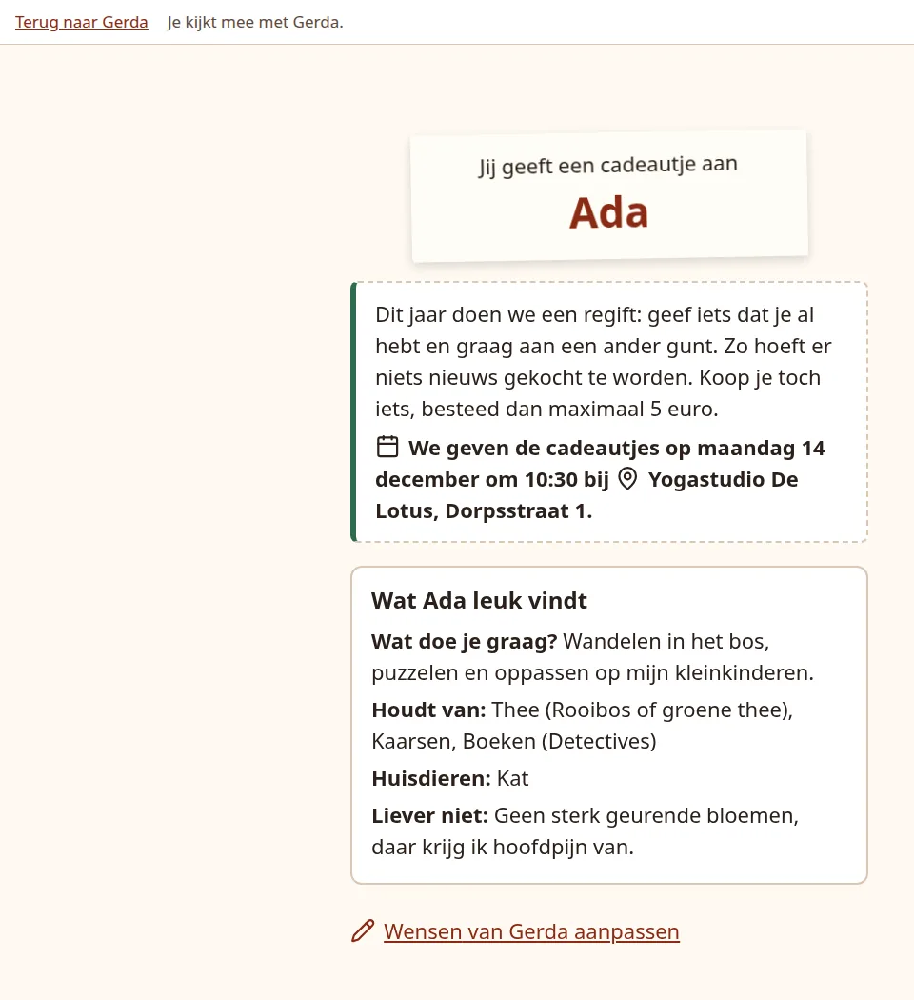
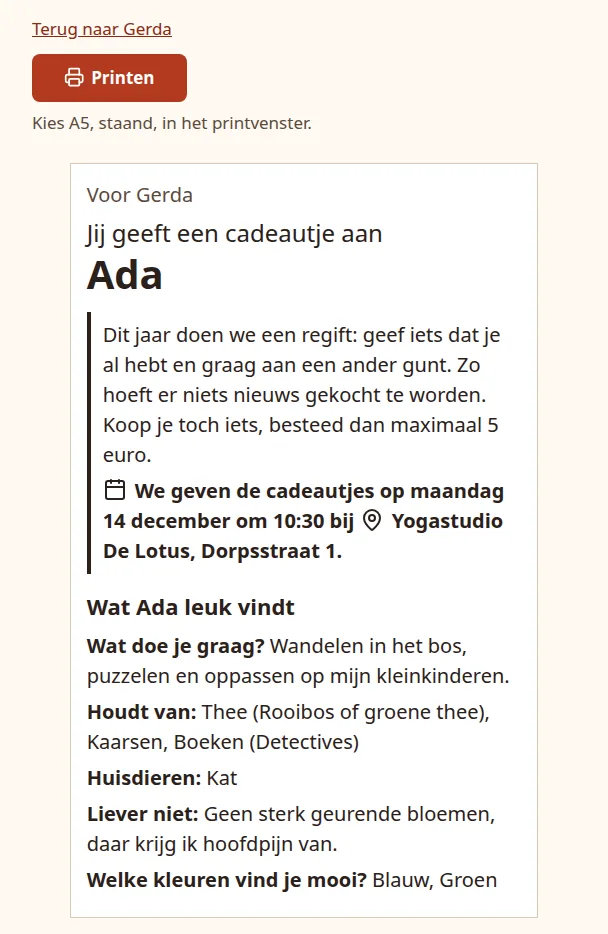

# Help someone in person

Not everyone has email or a phone, and some people would rather do it together. From a participant's page you can do everything for them on your own screen: fill in their wishes, draw with them beside you, and print a card that tells them who they give a present to.

## Open their page

On the group dashboard, click the person's name. The **Help ... in person** (*... persoonlijk helpen*) panel has three steps: wishes, draw, card. For someone without email this panel comes first and is highlighted, with the note that you fill in the wishes, draw together on your screen and print the card.

{ .shot }

The facts at the top never show who someone gives to before they have drawn; they only say **Paired** (*Ingedeeld*). After the draw the name is behind **Show who ... drew** (*Toon wie ... getrokken heeft*), which stays closed until you click it. So you can open the page with the person sitting next to you.

## Fill in their wishes

Click **Fill in the wishes of ...** (*De wensen van ... invullen*). You get the same form the participant sees on their own page, in their language, with a bar at the top saying **You are filling this in for ...** (*Je vult dit in voor ...*) and a link back to their page. Press **Save** (*Opslaan*); you return to their page with the note **The wishes are saved.**

Everything is optional, as it is for participants. If the person who gives to them has already drawn, that giver gets a "wishes updated" mail, just as when the participant changes them; see [Follow up](follow-up.md#mail-the-app-sends-by-itself).

## Draw together

Once drawing is open for the group, press **Draw for ...** (*Trekken voor ...*). Ideally the person sits beside you: the slip comes out of the bowl with the same animation as on their own page, and the name appears on your screen. The bar at the top reads **You are looking on with ...** (*Je kijkt mee met ...*).

{ .shot }

This counts as their draw, exactly as if they had pressed the button themselves. Afterwards the button reads **Show the drawn name again** (*De getrokken naam nog eens laten zien*) and shows the result without the animation. Before the group opens, the panel says drawing is not open yet.

## Print a card

After the draw, click **Open the card to print** (*Het kaartje openen om te printen*). The card says who it is for, who they give a present to, the theme, the date, time and place of the exchange, and what their person likes, in the participant's language.

{ .shot width="420" }

Press **Print** (*Printen*) and choose A5, portrait, in the print window. The buttons above the card are left off the paper. Long wishes make the type a little smaller so the card stays on one sheet.

Pressing Print records the card as printed, even if you then cancel the print window. The person's page shows **Printed on ...** and the dashboard's **Printed card** (*Geprinte kaart*) column says **Up to date** (*Klopt nog*).

### When a printed card goes out of date

The dashboard switches a card to **Print again** (*Opnieuw printen*), and the card page explains that something changed since the last print, when:

- their person changes their wishes or is renamed;
- they get a different person, because someone joined or dropped out;
- the group's date, time or place changes;
- the event's theme, choices, form parts or headings change.

The card always shows the current details, so printing it again is enough.

## Someone with a phone but no email

Show the QR code from the **Personal link** panel and let them scan it with their phone camera. It opens their own page, and they can take it from there.

Next: [changes after opening](changes.md).
