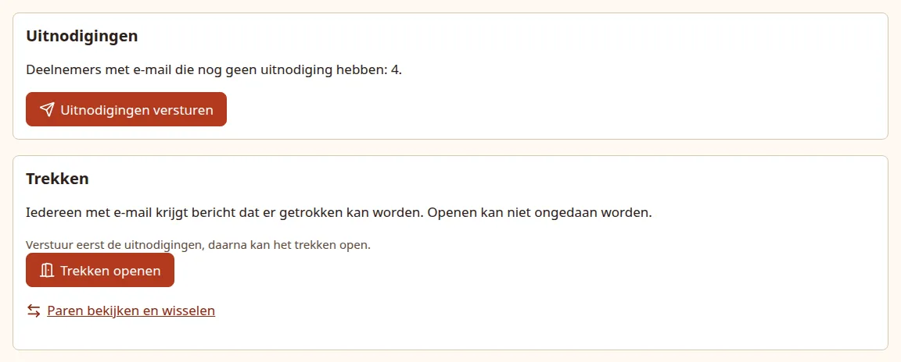
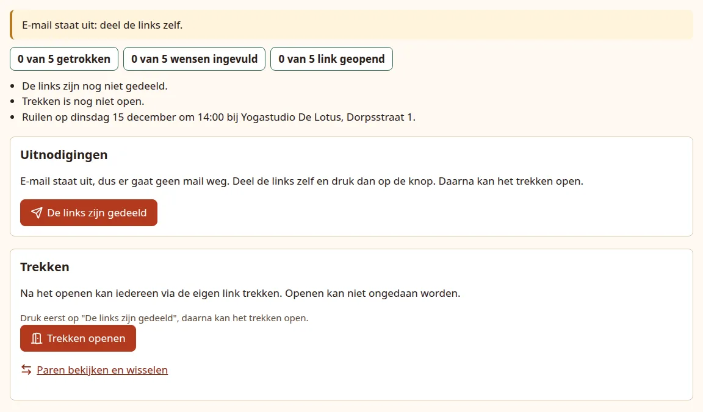
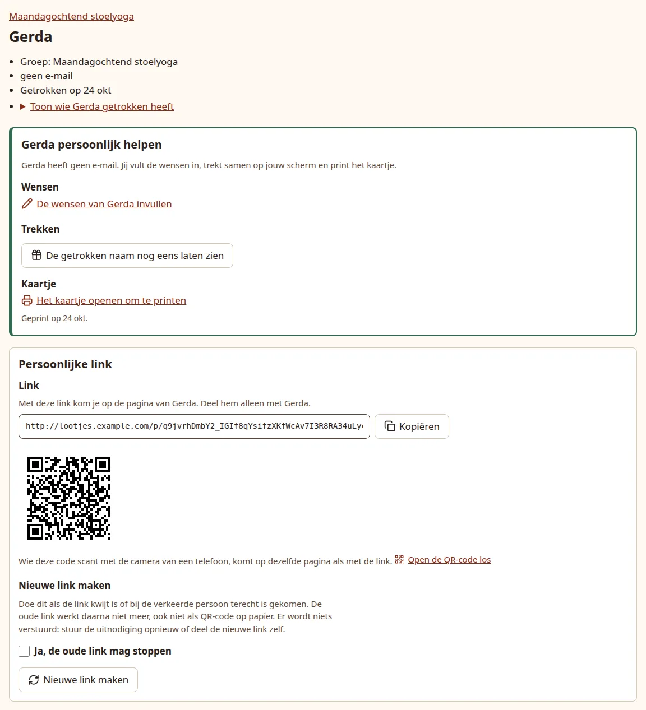

# Send the invitations

Every participant has a personal link, such as `https://gifts.example.com/p/` followed by a long random code. The link is the key to their page: no account or password is needed. Inviting people means getting that link to them, so they can say what they like before drawing opens.

You have to do this step once per group, even when nobody in it has email: drawing can only open after it.

!!! info "With sign-up, this step waits"

    While the event's [sign-up](signup.md) runs, the dashboard shows **Sign-up is on. Inviting and drawing come after it.** instead of the Invitations panel, and nobody can be invited, also not from a person's own page. When you [start the draw](signup.md#start-the-draw), the invitations go out for every group at once, so you do not press **Send invitations** yourself. Everything below applies again from then on.

## With email on

On the group dashboard, the **Invitations** (*Uitnodigingen*) panel says how many participants with email have no invitation yet. Press **Send invitations** (*Uitnodigingen versturen*).

{ .shot }

What happens:

- Everyone with an email address gets a welcome mail, usually within a minute, in their own language. The subject is "Gift Draw: Tell us a little about yourself" (*Lootjes trekken: Vertel iets over jezelf*). It has a big **Go to my page** button, the exchange date, the theme, and the link written out. See [the mails participants get](../participants.md#the-mails).
- The dashboard notes **Invitations sent on ...** and the **Invited** (*Uitgenodigd*) column shows each mail's state: **Queued** (*In de wachtrij*), **Sent** (*Verstuurd*), **Failed, retrying** (*Mislukt, wordt opnieuw geprobeerd*) or **Failed** (*Mislukt*). People without email show **Not applicable** (*Niet van toepassing*).
- Nothing is sent to people without email. Give them their link yourself, see below, or [help them in person](in-person.md).

Right after the press, the panel says **All invitations are ready.** with how many have been sent so far, the same number as **... of ... with email invited** (*... van ... met e-mail uitgenodigd*) above it; both count only mails that have actually gone out. Reload the page after a minute: once every invitation is sent, the panel says **Everyone with email has been invited.** (*Iedereen met e-mail is uitgenodigd.*). An invitation that fails keeps the panel on the count; see [When a mail fails](follow-up.md#when-a-mail-fails).

People you add to the group after this get their invitation automatically when you add them. The button comes back only when someone with email is still uninvited, for example after you gave a person an email address later; pressing it again sends only those missing invitations, never a second copy to people already invited.

## With email off

When the app runs without a mail server, the dashboard shows **Email is off: share the links yourself.** and the button reads **The links have been shared** (*De links zijn gedeeld*).

{ .shot }

1. Share each person's link yourself, see below.
2. Press **The links have been shared**. It sends nothing; it records that the group may open.

Afterwards the panel says you marked the links as shared. Give anyone who joins later their link yourself.

## Share a link yourself

Click a name in the participants table to open their page. The **Personal link** (*Persoonlijke link*) panel has three ways to pass the link on:

- **Copy** (*Kopiëren*) the link and send it in a message.
- Show the **QR code** on your screen, or open it on its own with **Open the QR code on its own** (*Open de QR-code los*) to print it. Scanning it with a phone camera opens the same page as the link.
- After the person has drawn, print their [card](in-person.md#print-a-card), which needs no link at all.

{ .shot }

!!! warning "Each link belongs to one person"

    Anyone who has the link sees that person's page, and after the draw who they give a present to. If a link reaches the wrong person, make a new one: see [Changes after opening](changes.md#a-link-reached-the-wrong-person).

## How you know someone has seen it

The **Link opened** (*Link geopend*) column shows the date someone first opened their page. With email on, the column header adds "(may include mail scanners)": some mail systems open every link in a mail to check it for danger, which can count as opened before the person ever looked.

Next: [check pairs and open the draw](open.md).
