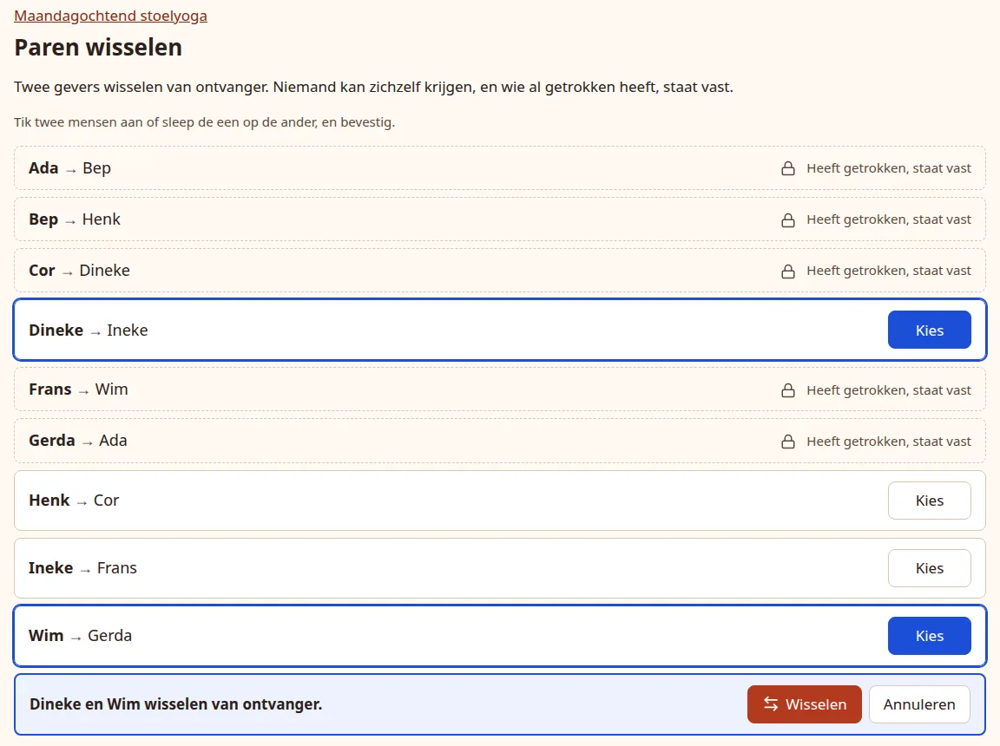
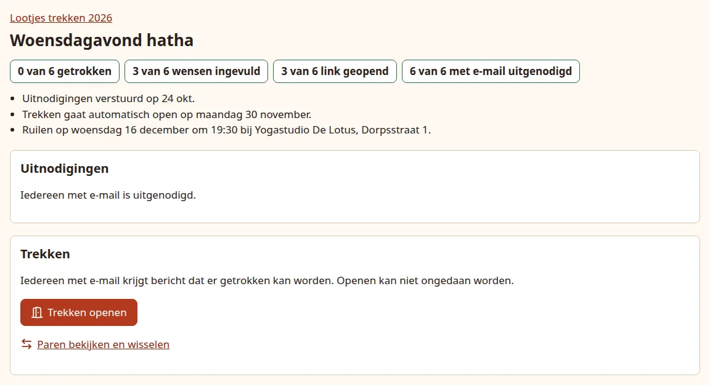

# Check pairs and open the draw

Once the invitations are out, participants can fill in their wishes. When you open drawing, they can also press **Draw a name** and see who they give a present to. You can look at the pairs and change them first.

## Look at the pairs and swap them

The **Drawing** (*Trekken*) panel on the dashboard has a **View and swap pairs** (*Paren bekijken en wisselen*) link once the group has pairs. The page lists every giver with the person they give to.

{ .shot }

To swap, tap **Select** (*Kies*) on two people, or drag one onto the other. A bar appears saying who swaps receivers, for example "Dineke en Wim wisselen van ontvanger." Press **Swap** (*Wisselen*) to do it, or **Cancel** (*Annuleren*). The page then confirms who gives to whom now.

- **Nobody can get themselves.** If a swap would do that, the bar says so and offers no Swap button. Pick someone else.
- **People who have drawn stay as they are**, marked **Has drawn, stays as is** (*Heeft getrokken, staat vast*). You can keep swapping the others after drawing has opened.
- **Two people may end up giving to each other.** The app allows that after a swap, although the original circle never does it.
- **A group of 3 cannot swap.** In a circle of three every swap would give someone themselves, so the page only shows the pairs.
- If the pairs changed in the meantime, for example because someone drew while you had the page open, the swap is refused with a message. Look at the current pairs and try again.

Without JavaScript in the browser, each row has a **Swap with** (*Wisselen met*) list and a **Swap** button instead.

## Open drawing

In the Drawing panel, tick **Yes, I am sure** (*Ja, ik weet het zeker*) and press **Open drawing** (*Trekken openen*). Without the tick nothing opens: the browser asks for it, and if the press reaches the app anyway the panel says to tick it first.

What happens:

- The group's participants can draw from now on. The panel says **Drawing is open. You can still swap people who have not drawn yet.** and the event page shows the group as **Drawing open** (*Trekken open*).
- With email on, everyone with an email address gets the mail "You can draw a name now" (*Je kunt nu een naam trekken*), with a **Draw a name** button.
- With email off nobody is told: let people know they can open their link and draw.

**Opening cannot be undone.** Afterwards you can still add and remove people and swap those who have not drawn; see [Changes after opening](changes.md).

While the event's [sign-up](signup.md) runs, the Drawing panel is not shown at all: nobody has pairs yet, and drawing can only open after you [start the draw](signup.md#start-the-draw).

The button is refused, with the reason shown in the panel, when:

- the invitations have not been sent yet: **Send the invitations first, then drawing can open.** With email off it asks you to press **The links have been shared** first;
- the group has fewer than 3 people.

## Let it open by itself

Give the group a date under **Drawing opens automatically on** (*Trekken gaat automatisch open op*) when you create or edit it. On that date, at 09:00 in the app's time zone, drawing opens exactly as if you had pressed the button, including the "You can draw a name now" mail.

{ .shot }

- It only opens if the invitations were sent (or, with email off, the links marked as shared) by then. If they were not, the dashboard warns **Drawing only opens once the invitations have been sent.** and the group waits; once you send them, it opens at the next check, which runs every minute.
- The date must be on or before the exchange date, and not in the past.
- While sign-up runs, a group does not open by itself, even when its date has passed. Once you start the draw its invitations are out, so it opens at the next check if its date has passed by then and it has pairs.
- You can still open drawing yourself earlier with the button.

Next: [help someone in person](in-person.md).
