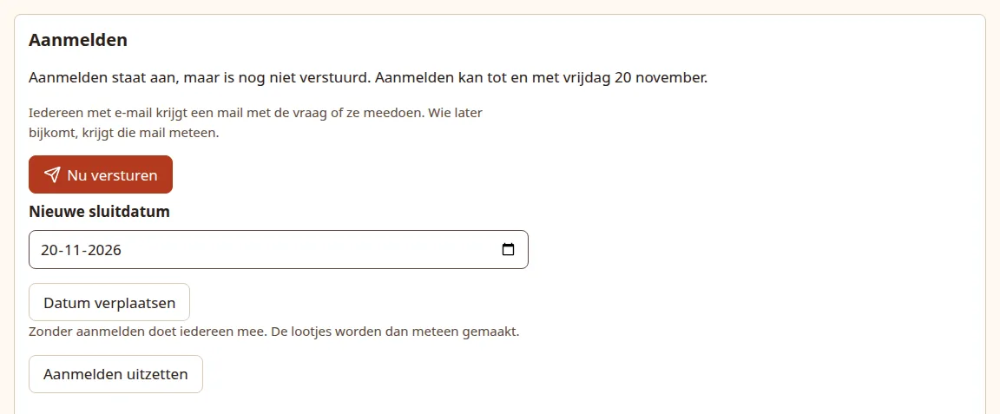
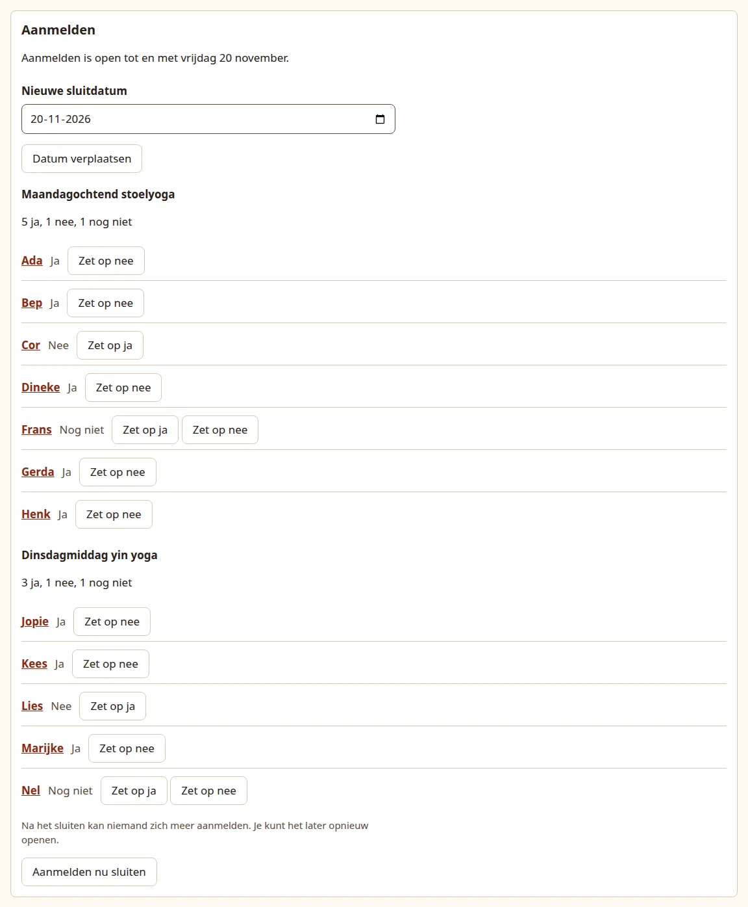
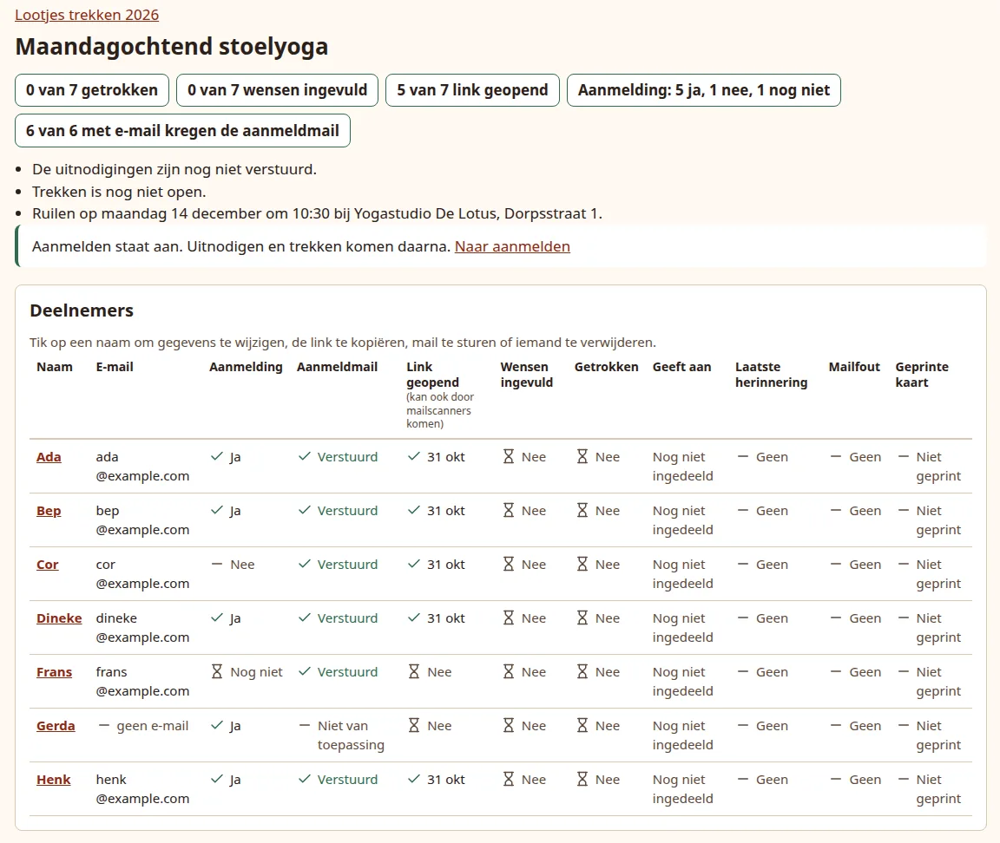
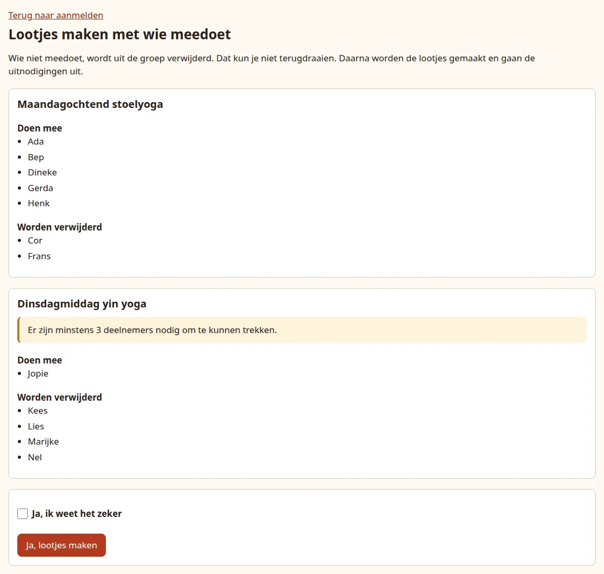

# Ask who takes part

Sign-up (*Aanmelden*) is an optional step before the draw. Instead of collecting on paper who joins this year, you add everyone in each group and the app asks them: each person answers yes or no on their own page, and only the people who said yes end up in the draw.

**Use it** when you do not know yet who takes part, for example a class where some people skip the exchange each year.

**Skip it** when you already know who joins. Then you add exactly those people and go straight on to [send the invitations](invitations.md). An event without sign-up works as the rest of this guide describes.

Sign-up is one step for the whole event: one closing date, one send and one start of the draw for all groups together.

## Before you start

- The event has its groups, each with its exchange date, and the people in them. See [Add groups and participants](groups.md). People you forget can still be added while sign-up runs.
- Nobody in the event has been invited yet: no group has had its invitations sent (or, with email off, been marked **The links have been shared**), and nobody got an invitation from their own page with **Resend invitation**. After that it is too late to ask, and the event page no longer shows the Sign-up panel.
- You know the closing date: the last day people can answer. It can be today or later, and must be before the first exchange date of the event. If a group has an automatic opening date, the closing date must also be before that day, because drawing cannot open while people are still answering.
- With email on, everyone with an email address gets the question by mail. People without email, or everyone when email is off, need their link from you or an answer given by you; see [Answer for someone](#answer-for-someone).

## The steps

1. [Turn on sign-up](#turn-on-sign-up) with the closing date.
2. [Send the question](#send-the-question) to everyone at once.
3. [While sign-up is open](#while-sign-up-is-open), people answer and the app reminds them. You can answer for someone, add people and move the date.
4. [Sign-up closes](#when-sign-up-closes) on the closing date, or earlier when you close it.
5. [Start the draw](#start-the-draw) with the people who said yes. From then on the event goes on as without sign-up, starting with the invitations.

## Turn on sign-up

On the event page, the **Sign-up** (*Aanmelden*) panel sits below the groups. Fill in **Sign-up is open until the end of** (*Aanmelden kan tot en met*) and press **Turn on sign-up** (*Aanmelden aanzetten*).

What happens:

- Nothing is sent yet. The panel now says sign-up is on but has not been sent, and lists every group with everyone's answer, all **Not yet** (*Nog niet*).
- Every group loses its pairs and shows **Not paired yet** (*Nog niet ingedeeld*). The pairs are made later, from the people who said yes.
- The group dashboards replace the Invitations and Drawing panels with **Sign-up is on. Inviting and drawing come after it.** (*Aanmelden staat aan. Uitnodigen en trekken komen daarna.*) and a link back to the sign-up panel.

{ .shot }

A closing date on or after the first exchange date is refused with **Choose a closing date earlier than the first exchange date.** (*Kies een sluitdatum die eerder is dan de eerste ruildatum.*) One on or after a group's automatic opening date is refused with **Choose a closing date earlier than the day drawing opens automatically. Or move that day in the group first.** (*Kies een sluitdatum die eerder is dan de dag waarop het trekken automatisch opengaat. Of verschuif eerst die dag bij de groep.*)

Until you send, you can still change your mind:

- **Move the date** (*Datum verplaatsen*) with a **New closing date** (*Nieuwe sluitdatum*).
- **Turn off sign-up** (*Aanmelden uitzetten*): everyone takes part again and every group of 3 or more is paired at once, as if sign-up had never been on. Once the question has gone out, this button is gone, because people's answers then count.

## Send the question

Check that every group is complete, then press **Send now** (*Nu versturen*). This is one press for the whole event.

With email on:

- Everyone with an email address gets the sign-up mail at once, in their own language: "Are you taking part in ...?" (*Doe je mee aan ...?*) with the event's name. It shows the theme, the exchange date, time and place of their group, the closing date, and two buttons: **Yes, I'm taking part** (*Ja, ik doe mee*) and **No, not this time** (*Nee, deze keer niet*).
- People without an email address get nothing. Give them their link yourself, as in [Share a link yourself](invitations.md#share-a-link-yourself), or answer for them.
- People whose answer you already set get nothing, now or later; see [Answer for someone](#answer-for-someone).

With email off the panel says so, and the button sends nothing: it opens sign-up. People can only answer after you press it; until then their page says **The organiser will soon ask you whether you are taking part.** (*De organisator vraagt je binnenkort of je meedoet.*) Share the links yourself, before or after pressing it.

The panel then says **Sign-up is open until the end of ...** (*Aanmelden is open tot en met ...*).

If the closing date has already passed before you send, **Send now** is gone and the panel says **The closing date has passed. Choose a new closing date below first, then you can send.** (*De sluitdatum is voorbij. Kies hieronder eerst een nieuwe sluitdatum, daarna kun je versturen.*) Sending then would open sign-up and close it at the same moment, so nothing is sent until you move the date.

## While sign-up is open

### How people answer

The buttons in the mail open the person's own page, which says **Almost done: tap below to confirm** (*Bijna klaar: tik hieronder om het te bevestigen*) above one large button for the answer they chose, with the other answer as a small link below it. **Opening the page records nothing**: the answer only counts once they press a button on the page. That protects the answers from mail programs that open every link to check it for danger.

After answering, the page says **You are taking part.** (*Je doet mee.*) or **You are not taking part this time.** (*Je doet deze keer niet mee.*) and what comes next. There is no answer button on that page, so an accidental second tap cannot change the answer: to change it they press **Change your answer** (*Antwoord veranderen*) first, and then choose again. They can change their answer as often as they like until the end of the closing date. [What participants see](../participants.md#signing-up) shows the pages.

The panel on the event page shows per group how many said yes, no and not yet, and each person's answer. A group with 1 or 2 yes answers shows **At least 3 participants are needed for drawing.** (*Er zijn minstens 3 deelnemers nodig om te kunnen trekken.*)

{ .shot }

### The class dashboard during sign-up

Each group's dashboard shows the answers too, from the moment sign-up is on until you start the draw:

- The **Participants** table gets a **Sign-up** (*Aanmelding*) column with each person's answer: **Yes** (*Ja*), **No** (*Nee*) or **Not yet** (*Nog niet*); after closing, **No answer, not taking part** (*Geen antwoord, doet niet mee*). This column is there with email off too.
- With email on, the **Invited** (*Uitgenodigd*) column is replaced by **Sign-up mail** (*Aanmeldmail*): the state of their sign-up mail (**Queued**, **Sent**, **Failed, retrying** or **Failed**), **Not yet** before you send, **Not needed, already answered** (*Niet nodig, al geantwoord*) for someone whose answer you set before sending, and **Not applicable** without an address.
- The counts at the top add the answers, for example **Sign-up: 2 yes, 1 no, 4 not yet** (*Aanmelding: 2 ja, 1 nee, 4 nog niet*), and with email on count the sign-up mails instead of the invitations: **6 of 7 with email were sent the sign-up mail** (*6 van 7 met e-mail kregen de aanmeldmail*). Only delivered mails count, and people whose answer you set before sending are left out of the total, because they need no mail.

{ .shot }

To set an answer, use the event page or the person's own page. Once you start the draw, the dashboard goes back to the usual columns and counts of [Follow up](follow-up.md#read-the-dashboard).

### What the app sends by itself

With email on, the app follows up on its own, only while sign-up is open. Only people who were sent the sign-up mail can get these; someone whose answer you set before pressing **Send now** never gets one.

| Mail | Who gets it | When |
| --- | --- | --- |
| Sign-up reminder: "7 days left to say whether you are taking part in ..." (*Nog 7 dagen om te zeggen of je meedoet aan ...*). It says their answer has not come in yet and asks them to choose and then confirm it on their page, which also fits someone who tapped a mail button but did not confirm. | Everyone who has not answered. | A week before the closing date, at 09:00. |
| Sign-up reminder: "2 days left to say ..." (*Nog 2 dagen om te zeggen ...*) | Everyone who still has not answered. | Two days before the closing date, at 09:00. |
| "Are you sure you are not taking part in ...?" (*Weet je zeker dat je niet meedoet aan ...?*) | Everyone whose answer is no at that moment. It says not taking part is perfectly fine, and that they can still change their mind. | Two days before the closing date, at 09:00. |

The number of days counts the whole days until the closing date, so with a closing date of Friday 20 November the reminders go out on Friday 13 November ("7 days left") and Wednesday 18 November ("2 days left"), and the "Are you sure?" mail also on 18 November. A reminder that only goes out on the closing date itself, for example because the app was not running, says that today is the last day: "Today is the last day to say whether you are taking part in ..." (*Vandaag nog: zeg of je meedoet aan ...*).

- Mail goes out between 09:00 and 20:00 in the app's time zone. If the app was not running at 09:00, the mail follows as soon as it runs again within that window.
- Nobody gets a reminder or the "Are you sure?" mail on the day they were sent the sign-up mail. A date that falls on or before that day is skipped, not sent late: with a closing date a week or less after sending, the first reminder is skipped, and with two days or less, none of these mails go out.
- Each person gets at most two sign-up reminders and at most one "Are you sure?" mail for the event, also when you move the closing date or open sign-up again.
- Someone who says no after the "Are you sure?" moment has just made up their mind and gets nothing more.
- A mail still waiting in the queue is dropped if it no longer fits: the person answered in the meantime, or sign-up closed.

The **Last reminder** (*Laatste herinnering*) column on the group dashboard includes the sign-up reminders.

### Answer for someone

Each person in the panel has **Set to yes** (*Zet op ja*) and **Set to no** (*Zet op nee*), minus the answer they already have; the same buttons are in the **Sign-up** panel on their own page. Use them for someone who told you their answer in person, or who has no email or phone. You can do this from the moment sign-up is on until you start the draw, also after sign-up has closed.

If you press the answer they already have, for example by tapping twice, nothing changes and the page simply comes back. If the answer changed after you opened the page, because the person answered in the meantime or you set it on another page, your press is refused and nothing is saved: the page says **...'s answer has changed in the meantime, by them or on another page. Nothing was saved. Below you see the answer as it is now.** (*Het antwoord van ... is intussen veranderd, door die persoon zelf of op een andere pagina. Er is niets opgeslagen. Hieronder zie je het antwoord van nu.*) Check the answer shown and press again if you still want to change it.

An answer you set counts like their own, so it also stops the reminders. Someone you set before pressing **Send now** gets no sign-up mail at all: no question, no reminders and no "Are you sure?" mail. A person who was sent the sign-up mail and whose answer is no two days before the closing date gets the "Are you sure?" mail, also when you set that no.

### Send the sign-up mail again

While sign-up runs, a person's page has no **Resend invitation** or **Send a reminder now**: invitations and reminders about wishes and drawing wait until you start the draw. While sign-up is open, the Email panel instead has **Send the sign-up mail again** (*Stuur de aanmeldmail opnieuw*) for someone with an email address who has not answered, for example after you corrected their address. It sends the sign-up mail with their current link and does not count toward the two automatic reminders. Someone who was never sent the mail is then counted as sent, so the reminders follow for them too.

### Add or remove people

- **Someone added while sign-up is open** gets the sign-up mail straight away, if they have an email address. Their reminders follow the same dates, but never on the day they were added.
- **Someone added before you send** gets the mail with everyone else when you press **Send now**.
- **Someone added after sign-up closed** counts as yes: you added them on purpose. Set them to no if that is wrong. They get no sign-up mail; their invitation follows when you start the draw.
- **Removing someone** works as usual from their page. There are no pairs to change yet, so the preview only says so.

Nobody is paired while sign-up runs, also not people you add. A new or changed group needs an exchange date after the closing date, or it is refused with **The exchange date must be after the sign-up closing date.** (*De ruildatum moet na de sluitdatum van het aanmelden liggen.*) An automatic opening date, if the group has one, must also be after the closing date, or it is refused with **Drawing can only open automatically after the sign-up closing date.** (*Het trekken kan pas automatisch opengaan na de sluitdatum van het aanmelden.*)

### Move the closing date

Fill in **New closing date** and press **Move the date**. The date can be today or later, and must be before the first exchange date and before any group's automatic opening date. Reminders follow the new date, within the limits above.

## When sign-up closes

Sign-up closes by itself when the closing date is over, at midnight in the app's time zone, so people can answer through the whole last day. To close it earlier, press **Close sign-up now** (*Aanmelden nu sluiten*).

After closing:

- Nobody can answer any more. A person who opens their page reads **Sign-up is closed.** (*Aanmelden is gesloten.*), whether they take part, and that they should ask you if they want to change that.
- **Anyone who did not answer does not take part.** The panel shows them as **No answer, not taking part** (*Geen antwoord, doet niet mee*), and the counts become who takes part and who does not.
- The Sign-up panel and each group's dashboard show a notice with the day sign-up closed and how many people did not answer, for example **Sign-up closed on Friday 20 November. 3 people did not answer. They do not take part.** (*Aanmelden is gesloten op vrijdag 20 november. 3 mensen hebben niet geantwoord. Zij doen niet mee.*) The panel counts the whole event, a dashboard its own group.
- Below it, the notice names everyone **without an email address who did not answer**. They may never have been asked, because the app had no way to mail them. If you know what they want, set them to yes or no.
- Nothing else happens yet, and nobody is told that sign-up closed. Look at the lists, call people you still want to hear from, and set answers where needed.

### Open sign-up again

Until you start the draw, you can open sign-up again: fill in a new closing date, today or later and before the first exchange date and any group's automatic opening date, and press **Open again** (*Opnieuw openen*). If a group's automatic opening date has already passed, change or clear it on its dashboard first. Everyone can answer or change their answer again until the end of that date. Reminders follow the new date, but nobody gets more than two sign-up reminders or a second "Are you sure?" mail in total.

## Start the draw

Once sign-up has closed and the lists are right, press **Make the pairs** (*Lootjes maken*) in the panel. You first see a confirmation page, **Make the pairs with everyone taking part** (*Lootjes maken met wie meedoet*), with the day sign-up closed and per group who takes part and who **Will be removed** (*Worden verwijderd*). Above the groups it lists the people without an email address who did not answer, who will be removed unless you set them to yes first.

A group whose automatic opening date is today or has passed is marked **Drawing in this group opens right after you make the pairs: its automatic opening day is today or has passed.** (*Het trekken gaat in deze groep meteen open als je de lootjes maakt: de dag om automatisch te openen is vandaag of al voorbij.*) A group where nobody takes part is named with **...: nobody is taking part, the group will be empty.** (*...: niemand doet mee, de groep wordt leeg.*); you can still go ahead, and that group ends up without anyone in it.

{ .shot }

Tick **Yes, I am sure** (*Ja, ik weet het zeker*) and press **Yes, make the pairs** (*Ja, lootjes maken*). Use **Back to sign-up** (*Terug naar aanmelden*) to change answers first.

### When a group has only one or two people taking part

Drawing needs at least 3 people in a group, so the draw cannot start while any group has one or two people taking part. The confirmation page then has no confirm button. It says **You cannot make the pairs yet. Drawing needs at least 3 people taking part in a group. These groups have fewer:** (*Je kunt de lootjes nog niet maken. Voor trekken zijn in een groep minstens 3 mensen nodig die meedoen. In deze groepen zijn het er minder:*), names each such group with how many take part, for example **Monday class: 2 taking part** (*Maandagles: 2 doen mee*), and marks it **At least 3 participants are needed for drawing.** Nobody is removed and nothing is sent.

Fix it, then press **Make the pairs** again:

- **Set more people in that group to yes**, for example someone who told you in person, or
- **Remove the group** on its dashboard if it is not taking part this time. Removing a group removes everyone in it.

You can also add someone to the group: after closing, a person you add counts as yes.

What happens:

- **Everyone who does not take part is removed** from their group: those who said no and those who did not answer. Their links stop working and their data is erased. This cannot be undone.
- **Each group is paired** from the people who are left, in one circle as described in [How pairing works](groups.md#how-pairing-works). A group where nobody takes part is left empty.
- **The invitations go out for every group**, as if you had pressed **Send invitations** on each dashboard: with email on, everyone with an address gets the usual invitation mail. With email off nothing is sent and every group counts as **The links have been shared**; share the links yourself.
- The panel says **Sign-up is finished.** (*Aanmelden is afgerond.*). It cannot be turned on again for this event.

From here everything works as without sign-up: [check the pairs and open the draw](open.md), add late joiners (they are paired and invited straight away), and follow up. A group with pairs whose automatic opening date has come opens within a minute after you start the draw (from 09:00 on that day), because its invitations have now gone out.

## What sign-up does not change

- People only draw within their own group, and the draw itself, the wish form, the reminders about wishes and drawing, and the printed cards work as before.
- Each person keeps one personal link: the same link answers the sign-up question and later leads to their wishes and the draw.
- The sign-up page only asks yes or no. People fill in their wishes after the invitation, when the draw has started.
- An [event file](import.md) does not carry the sign-up setting. Import the event, then turn on sign-up on its event page.

Next: [send the invitations](invitations.md), which happens by itself when you start the draw after sign-up.
