# What participants see

A participant only ever sees their own page, reached through their personal link from a mail, a message or a QR code. There is no login, no app to install, and one main button per screen. This tour follows Ada through her page so you know what to tell your group.

The page is in the participant's language. A button at the bottom switches between Nederlands and English; on the wish form, switching first saves what was typed so far, so nothing has to be typed again.

## Signing up

Only when the organiser [asks who takes part](guide/signup.md) first. Until the organiser starts the draw, the page shows this step instead of everything below.

{ .shot width="240" }

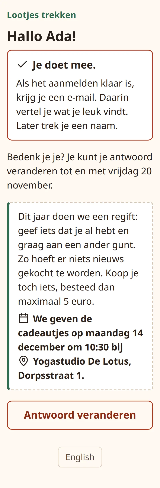{ .shot width="240" }

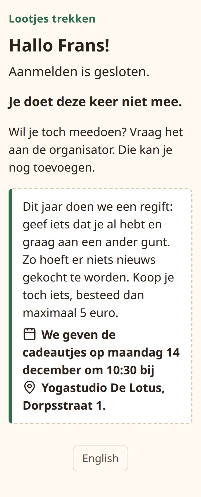{ .shot width="240" }

1. **The question.** With email on, the sign-up mail has a yes button and a no button. Either opens their page, which says **Almost done: tap below to confirm** (*Bijna klaar: tik hieronder om het te bevestigen*) above one large button for the chosen answer, with the other answer as a small link below it: **I will take part after all** (*Ik doe toch mee*) or **Not after all? No, not this time** (*Toch niet? Nee, deze keer niet*). Opening the page does not answer yet; the tap on the page does. Opened from their link without a mail button, the page asks the question with both buttons, **Yes, I'm taking part** (*Ja, ik doe mee*) and **No, not this time** (*Nee, deze keer niet*). The page shows the theme, the exchange date with time and place, and until when they can answer.
2. **Answered.** The page says **You are taking part.** (*Je doet mee.*) or **You are not taking part this time.** (*Je doet deze keer niet mee.*) in a box, with what comes next: after a yes, that an email follows when sign-up is finished to tell what they like, and that they draw a name later (without an email address, that they do this on the same page); after a no, that they do not need to do anything else. The page has no answer button, so a second tap cannot undo the answer. To change it they press **Change your answer** (*Antwoord veranderen*), which shows both answers again with **Keep my answer** (*Laat mijn antwoord zo*) to go back. They can change it until the end of the closing date.
3. **Closed.** After the closing date the page says **Sign-up is closed.** (*Aanmelden is gesloten.*) and whether they take part. Anyone who did not answer does not take part. To change it, they tell the organiser, for example in class. An answer pressed on a page opened before closing is not saved, and the page says so: **Your answer was not saved, because sign-up is closed.** (*Je antwoord is niet bewaard, want aanmelden is gesloten.*)

Someone who opens their link before the organiser has sent the question reads **The organiser will soon ask you whether you are taking part.** (*De organisator vraagt je binnenkort of je meedoet.*)

When the organiser starts the draw, people who take part get the usual invitation and continue below. The links of people who do not take part stop working.

## Before drawing opens

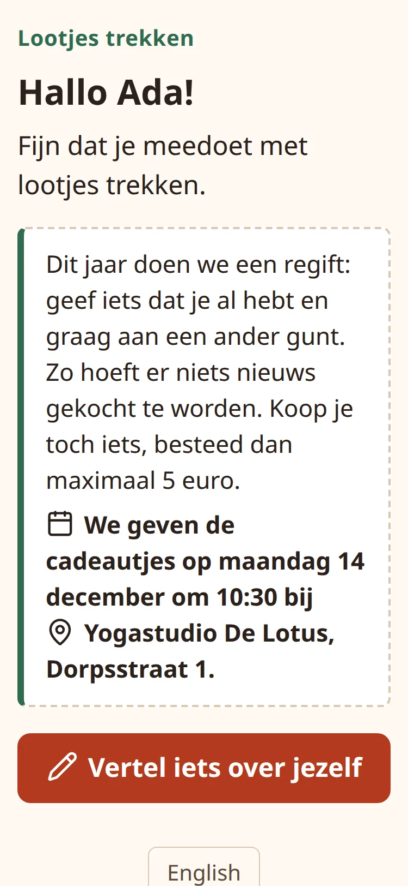{ .shot width="240" }

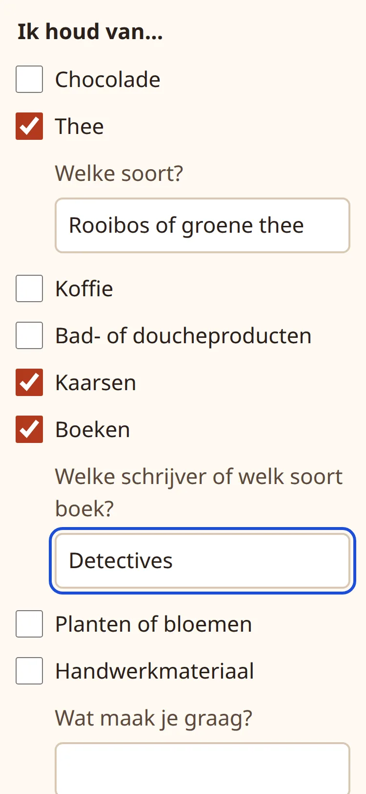{ .shot width="240" }

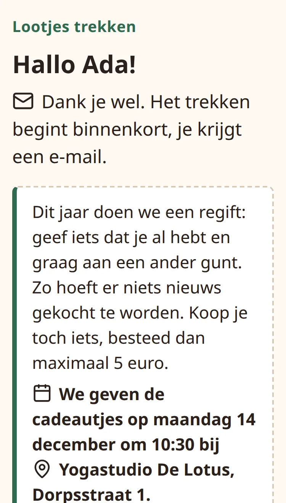{ .shot width="240" }

1. **Welcome.** A greeting with their name, the theme, and the exchange date with time and place. One button: **Tell us a little about yourself** (*Vertel iets over jezelf*).
2. **About me** (*Over mij*). The wish form, with the questions and choices you set for the event. Everything is optional; the page says so at the top. Ticking a choice that has a question shows a small text field under it. **Save** (*Opslaan*) stores the answers.
3. **Thank you** (*Dank je wel*). The page says drawing opens soon and that they will get an email. Someone without email, or everyone when email is off, reads that the organiser will let them know. **Change my answers** (*Mijn antwoorden aanpassen*) opens the form again.

## Drawing

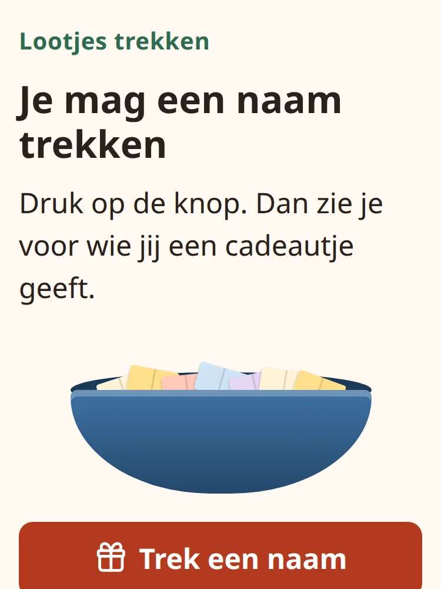{ .shot width="240" }

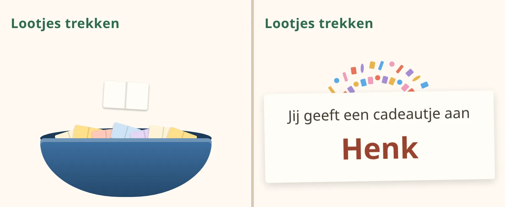{ .shot width="480" }

Once drawing is open, the page shows a bowl of paper slips and one button: **Draw a name** (*Trek een naam*). This is the first screen for anyone who opens their link after drawing opened, even if they never filled in their wishes.

Pressing it plays a short animation of about three seconds: the bowl shakes, a slip comes out and unfolds with the name, and confetti falls. Tapping the screen skips straight to the name. People whose device asks for reduced motion get a calmer, shorter version.

## The result

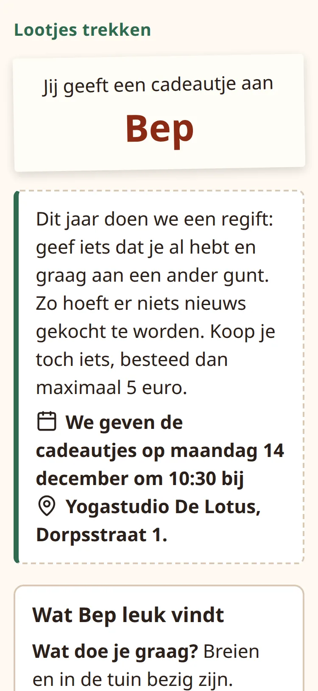{ .shot width="240" }

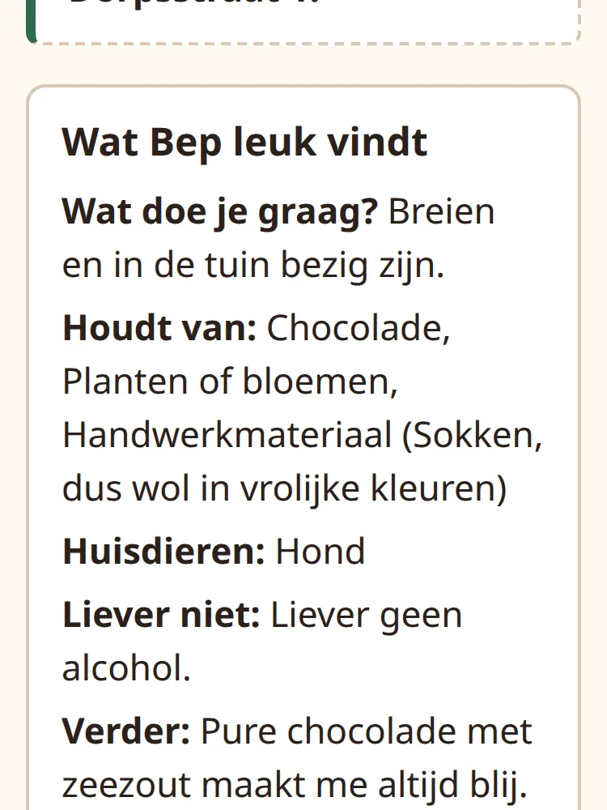{ .shot width="240" }

The result page shows who they give a present to, the theme, the exchange date with time and place, and **What ... likes** (*Wat ... leuk vindt*): the answers of their person, one line per answered question in the order of the form. A standard question is labelled with its short name, such as *Houdt van*; a question with your own wording is labelled with that wording. Hidden questions are left out. If their person has not filled in anything yet, it says so; a "wishes updated" mail follows if they do later.

Opening the link again later shows the same result, so the link works as a reminder up to the exchange. Below the wishes, **Change my own answers** (*Mijn eigen antwoorden aanpassen*) leads back to their own form, or **Tell us what you like** (*Vertel wat jij leuk vindt*) if they have not filled in anything.

## The mails

With email on, every mail has the participant's name, one big button to their page, the exchange date, the theme, and the link written out for mail programs that hide buttons. Each ends with the note that the link is just for them and should not be forwarded. Every subject starts with the app's name, "Gift Draw" or "Lootjes trekken". The sign-up mail and its reminders have two buttons, yes and no, instead of one.

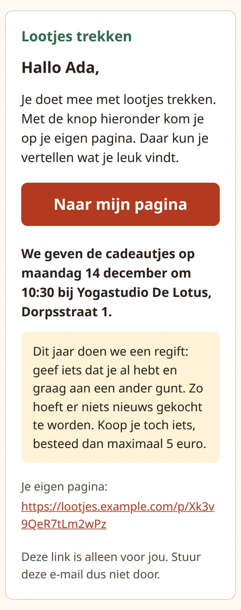{ .shot width="240" }

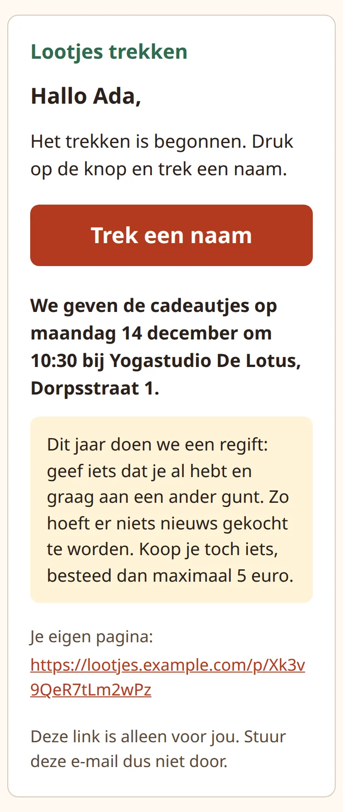{ .shot width="240" }

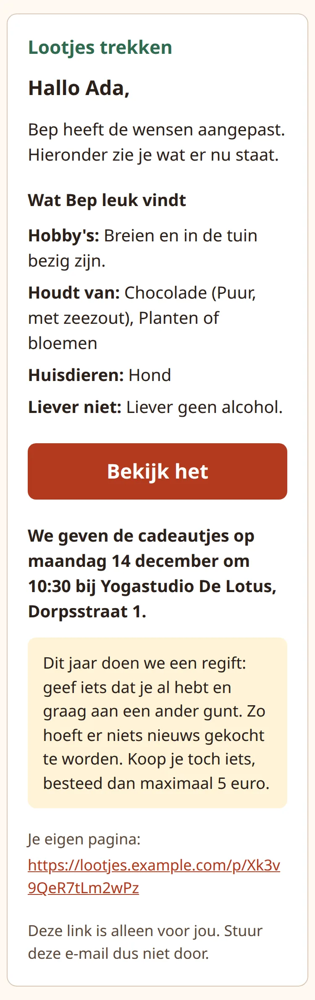{ .shot width="240" }

| Mail | Subject (English / Dutch) | When |
| --- | --- | --- |
| Sign-up | Are you taking part in ...? / Doe je mee aan ...? | With sign-up on, when you send the question, or when you add them while sign-up is open. |
| Sign-up reminder | 7 days left to say whether you are taking part in ... / Nog 7 dagen om te zeggen of je meedoet aan ... (2 days in the second) | Up to two, to people who have not answered. |
| Are you sure? | Are you sure you are not taking part in ...? / Weet je zeker dat je niet meedoet aan ...? | At most once, to people who said no. |
| Invitation | Tell us a little about yourself / Vertel iets over jezelf | When you send the invitations, or start the draw after sign-up. |
| Invitation into an open group | You can draw a name straight away / Je kunt meteen een naam trekken | A newcomer added after drawing opened. |
| Drawing is open | You can draw a name now / Je kunt nu een naam trekken | When the group opens. |
| Wishes reminder | Would you tell us a little about yourself? / Vertel je nog iets over jezelf? | Up to two, before drawing opens. |
| Draw reminder | Remember to draw a name / Vergeet niet een naam te trekken | Up to two, after drawing opens. |
| Wishes updated | ... has changed their wishes / ... heeft de wensen aangepast | Their person changed their wishes after they drew. |
| Person changed | Your person has changed / Je lootje is veranderd | Someone joined or dropped out and they give to someone else now. |

[Follow up](guide/follow-up.md) explains the timing of each; the sign-up mails are timed as in [Ask who takes part](guide/signup.md#what-the-app-sends-by-itself).

## If something goes wrong for a participant

- **"This link does not work. The organiser may have given you a new link."** (*Deze link werkt niet. Misschien heeft de organisator je een nieuwe link gegeven.*): the link is incomplete, you made a new link for them, or they were removed from the group. The page goes on to tell them to look for a newer email or ask you for their new link, so send them the current one. A page they still had open with the old link gets the same message when they press a button, and nothing on it is saved.
- **"Too much at once. Please try again in a minute."** (*Even te veel tegelijk.*): too many attempts from the same internet connection, for example many wrong links tried in a row. Waiting a minute helps.
- **"This page was out of date: your answers or the questions changed in the meantime. Nothing was saved."** (*Deze pagina was niet meer actueel: je antwoorden of de vragen zijn intussen veranderd. Er is niets opgeslagen.*): they saved a wish page that was opened before you changed the questions (always refused), or before a newer save on another tab or device or by you on their behalf (refused only when it would change something). Nothing on it was stored, so newer answers are kept and their giver gets no mail. The form now shows what is saved; what they had just filled in is listed above it under **What you had just filled in (not saved)** (*Dit had je net ingevuld (niet opgeslagen)*). Whatever they put in the form and save is what gets stored.
- **They lost the link.** Copy it from their page, show the QR code, or press **Resend invitation**.
